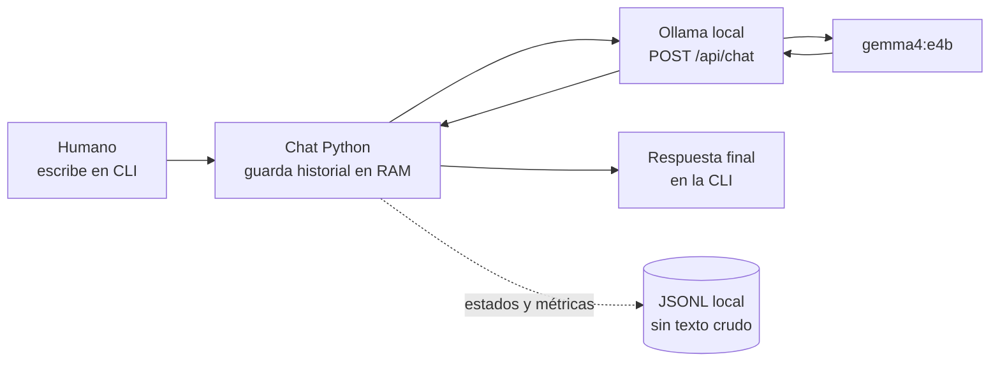

# Aprende el agente más pequeño posible

Este laboratorio responde una pregunta concreta: **¿cuál es el camino mínimo para conversar con un modelo local desde la terminal?**

Al terminar podrás explicar y ejecutar estos cuatro pasos:

1. El humano escribe texto en PowerShell.
2. Python añade ese mensaje al historial en memoria.
3. El cliente envía el historial a `gemma4:e4b` por la API local de Ollama.
4. La terminal muestra únicamente la respuesta final del modelo.

## Antes de empezar

- **Conocimientos:** haber terminado el laboratorio 01 ayuda, pero no es obligatorio.
- **Software:** `uv` y Ollama con `gemma4:e4b` (`ollama list` debe mostrarlo).
- **Vocabulario:** [contexto](../../../docs/humano/maestro/GLOSARIO.md#contexto),
  [instrucción de sistema](../../../docs/humano/maestro/GLOSARIO.md#instrucción-de-sistema) y
  [memoria de sesión](../../../docs/humano/maestro/GLOSARIO.md#memoria-de-sesión).

## Mapa visual

## Tres conceptos

### Modelo

`gemma4:e4b` genera la respuesta. Sus pesos y su ejecución pertenecen a Ollama, no a este repositorio.

### Agente mínimo

Aquí “agente” significa una aplicación que recibe una observación del humano, prepara contexto, solicita una decisión al modelo y devuelve el resultado. Todavía no actúa sobre herramientas ni sobre el sistema.

### Memoria de conversación

El programa conserva en RAM los mensajes anteriores y vuelve a enviarlos en el turno siguiente. Al cerrar la CLI se pierde esa memoria. La traza JSONL conserva métricas y estados, no la conversación.

### Comandos locales

`/ayuda`, `/memoria`, `/olvidar` y `/salir` los resuelve el programa sin llamar al modelo. Sirven
para **mirar dentro de la memoria**: `/memoria` cuenta mensajes, caracteres y tokens; `/olvidar`
vacía la lista y demuestra que, sin historial, el modelo no recuerda nada.

## Recorrido guiado

1. Sigue [QUICKSTART.md](QUICKSTART.md) y abre el chat.
2. Escribe: `Recuerda que mi color de prueba es verde.`
3. Ejecuta `/memoria` y observa cuántos mensajes hay en RAM.
4. Pregunta: `¿Cuál es mi color de prueba?`
5. Ejecuta `/olvidar` y vuelve a preguntar. Compara las dos respuestas.
6. Sal con `/salir` y valida la traza.
7. Recorre [EXAMPLES.md](EXAMPLES.md) y continúa con [EXERCISES.md](EXERCISES.md).

## Qué no hace

- No busca en internet.
- No lee archivos ni ejecuta comandos.
- No guarda conversaciones ni PII.
- No cambia de modelo ni usa una API pagada como fallback.
- No muestra el campo de pensamiento del modelo.

La arquitectura exacta está en [ARCHITECTURE.md](ARCHITECTURE.md); los fallos esperados están en [TROUBLESHOOTING.md](TROUBLESHOOTING.md).

## Dónde encaja en la ruta

- **Antes:** [01-prompt-agent-factory](../../../01-prompt-agent-factory/docs/humano/README.md), que
  define agentes como contratos sin ejecutarlos.
- **Después:** [03-orchestration](../../../03-orchestration/docs/humano/README.md), que usa este mismo
  agente único como **línea base** frente a un equipo de tres roles.
