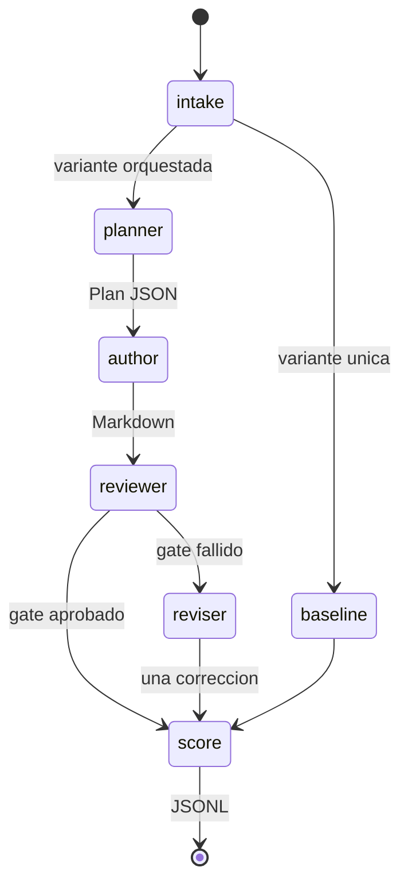

# Arquitectura explicada

## Corte vertical

Cada color del grafo corresponde a un evento `node.queued`, `node.started`, `node.completed` o `node.failed`. El frontend no inventa actividad.

## Componentes

| Componente | Entrada | Salida | Responsabilidad |
|---|---|---|---|
| `main.py` | HTTP | SSE y snapshot | Arranca la corrida y expone el estado |
| `orchestrator.py` | Tarea y flags | Variantes y comparación | Secuencia de roles y una corrección |
| `ollama_client.py` | Mensajes | `ChatResult` | `POST /api/chat` local |
| `scoring.py` | Markdown | Checks | Gate determinista de `I-ORCH-001` |
| `run_log.py` | Eventos | JSONL | Observabilidad sin texto crudo |
| `App.tsx` | Snapshot | Grafo React Flow | Visualización derivada de la API |

## Contratos de handoff

El planificador debe devolver:

- `title`
- `audience`
- `outline` con cuatro secciones
- `success_checks`

El autor y el agente único devuelven Markdown. El revisor intenta devolver:

- `passed`
- `checks`
- `required_changes`

Si ese JSON es inválido, el nodo revisor termina igual: el gate usa `scoring.py`.

## Comparación

Gana la variante que aprueba el gate. Si ninguna o ambas aprueban, gana quien suma más checks. Un empate se declara como `tie`. La latencia se registra pero no desempata: más agentes suelen tardar más.

## Persistencia

No hay SQLite. El dashboard vive en memoria. La evidencia durable es `.local/runs/*.jsonl` y el Markdown completo en `.local/artifacts/<run_id>/`. El JSONL guarda headings, conteos, hashes y una vista previa corta.

## Puertos

- API: `127.0.0.1:8012`
- UI: `127.0.0.1:5172`

Vite reenvía `/api` al backend. No hay CORS abierto a otros orígenes.

## Errores

Un fallo de transporte con Ollama termina la corrida. Un Plan JSON inválido solo tumba la variante orquestada: la línea base todavía sirve para comparar. No hay reintentos ocultos.
