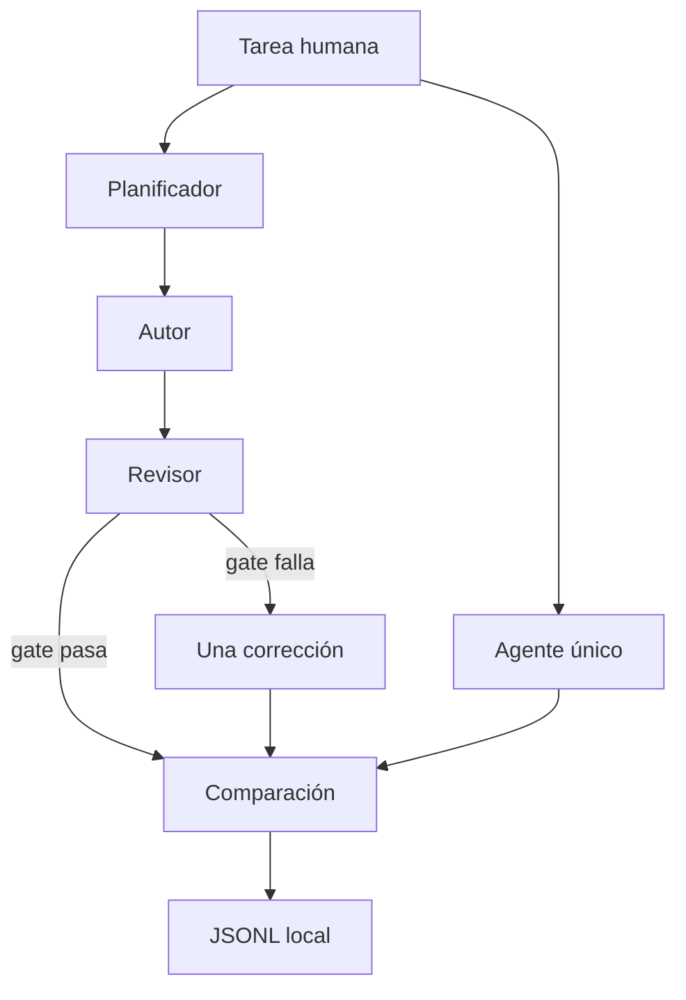

# Aprende a orquestar sin perder la línea base

Este laboratorio responde una pregunta concreta: **¿qué mejora realmente al separar una tarea entre agentes especializados?**

Al terminar podrás explicar y ejecutar estos cinco pasos:

1. La misma tarea alimenta un agente único y un pipeline de tres roles.
2. El planificador entrega un JSON con secciones obligatorias.
3. El autor escribe Markdown a partir de ese plan.
4. Un revisor modelo opina, pero el aprobado lo decide una lista de checks en código.
5. El dashboard muestra nodos, handoffs, latencia y el JSONL sanitizado.

## Antes de empezar

- **Laboratorio previo:** [02-single-agent](../../../02-single-agent/docs/humano/README.md); su chat
  es la idea de «agente único» que aquí se usa como línea base.
- **Software:** `uv`, Ollama con `qwen3.5:4b` y, para el dashboard, Node.js.
- **Vocabulario:** [línea base](../../../docs/humano/maestro/GLOSARIO.md#línea-base),
  [handoff](../../../docs/humano/maestro/GLOSARIO.md#handoff) y
  [gate determinista](../../../docs/humano/maestro/GLOSARIO.md#gate-determinista).
- **Sin Ollama** puedes practicar el gate con `uv run orchestration-score`.

## Mapa visual

## Cuatro conceptos

### Agente único

Un solo llamado al modelo produce toda la guía. Es la línea base. Sin ella, añadir roles solo añade teatro.

### Handoff

El plan no es un comentario: es un objeto JSON con título, audiencia, outline y checks. El autor no improvisa la estructura; la recibe.

### Gate determinista

El revisor puede devolver JSON. Si ese JSON es inválido, el experimento no se rinde: el código busca headings, Ollama, PowerShell, una condición de parada y la ausencia de marcas cloud.

### Una corrección

Si el gate falla, el autor recibe los checks rotos y reescribe una vez. Un ciclo con presupuesto de iteraciones pertenece al laboratorio de loops.

## Una analogía

Piensa en una redacción: una persona escribe el artículo sola (agente único) o un editor hace el
índice, un redactor lo escribe y un corrector lo revisa (orquestación). Para saber si el equipo
«mejoró» el artículo hacen falta dos cosas: el artículo escrito por una sola persona para comparar
y una lista de requisitos objetiva. Aquí esa lista es el gate de nueve checks.

## Recorrido guiado

1. Sigue [QUICKSTART.md](QUICKSTART.md).
2. Practica el gate sin modelo con los [ejemplos 1 a 3](EXAMPLES.md).
3. Carga el caso `I-ORCH-001` en el dashboard.
4. Observa cómo el nodo de agente único y el de planificador parten del mismo intake.
5. Compara los checks de las dos variantes y aplica la [regla de comparación](EXAMPLES.md#ejemplo-5--la-regla-de-comparación).
6. Valida el JSONL y continúa con [EXERCISES.md](EXERCISES.md).

## Qué no hace

- No ejecuta agentes en paralelo.
- No usa LangGraph, CrewAI ni AG2.
- No llama a APIs cloud ni tiene fallback pagado.
- No muestra el pensamiento privado del modelo.
- No conserva el Markdown completo dentro del JSONL.

La arquitectura exacta está en [ARCHITECTURE.md](ARCHITECTURE.md).

## Dónde encaja en la ruta

- **Antes:** [02-single-agent](../../../02-single-agent/docs/humano/README.md).
- **Después:** [04-parallel-agents](../../../04-parallel-agents/docs/humano/README.md), que pregunta
  si varias ramas **independientes** pueden correr a la vez sin perder procedencia.
