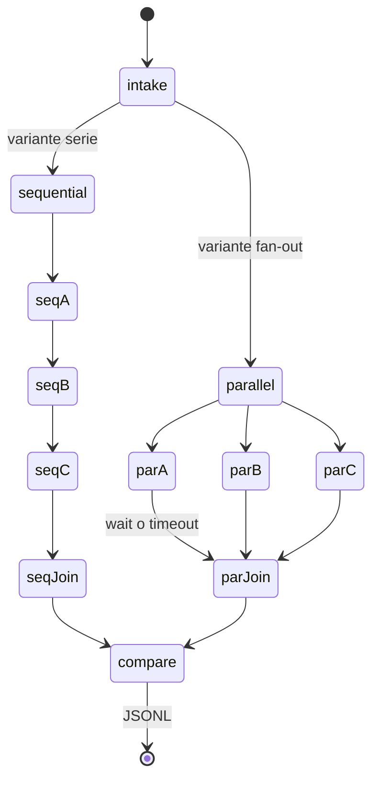

# Arquitectura explicada

## Corte vertical

Cada color del grafo corresponde a un evento `node.queued`, `node.started`, `node.completed` o `node.failed`. El frontend no inventa actividad.

## Componentes

| Componente | Entrada | Salida | Responsabilidad |
|---|---|---|---|
| `main.py` | HTTP | SSE y snapshot | Arranca la corrida y expone el estado |
| `orchestrator.py` | Tarea y flags | Dos variantes | Serie frente a `asyncio.gather` |
| `ollama_client.py` | Mensajes | `ChatResult` | `POST /api/chat` local |
| `scoring.py` | Ramas y tabla | Checks | Gate determinista de `I-PARALLEL-002` |
| `run_log.py` | Eventos | JSONL | Observabilidad sin texto crudo |
| `App.tsx` | Snapshot | Grafo React Flow | Visualización derivada de la API |

## Contratos de handoff

Cada extractor debe devolver un `FactBundle`:

- `source_id` (`source-a`, `source-b` o `source-c`)
- `facts` con `fact_id`, `topic`, `value` y `evidence`

El agregador es código, no un cuarto modelo. Une solo las ramas `completed`. Las `failed` y `timeout` quedan fuera de la tabla y en `failed_sources`.

## Comparación

Primero se mira la coherencia: si el paralelo pierde fuentes, no gana aunque sea más rápido. Si ambas aprueban, gana quien tenga menor tiempo de pared. Una banda del 5% se declara `tie`.

## Persistencia

No hay SQLite. El dashboard vive en memoria. La evidencia durable es `.local/runs/*.jsonl` y las tablas Markdown en `.local/artifacts/<run_id>/`. El JSONL guarda `source_id`, `fact_ids`, hashes y una vista previa corta.

## Puertos

- API: `127.0.0.1:8014`
- UI: `127.0.0.1:5175`

Vite reenvía `/api` al backend. No hay CORS abierto a otros orígenes.

## Errores

Un timeout de rama no tumba a las demás. Un JSON inválido marca esa fuente como fallida. Un fallo de transporte con Ollama puede dejar las tres ramas en `failed`; no hay fallback cloud ni reintentos ocultos.
