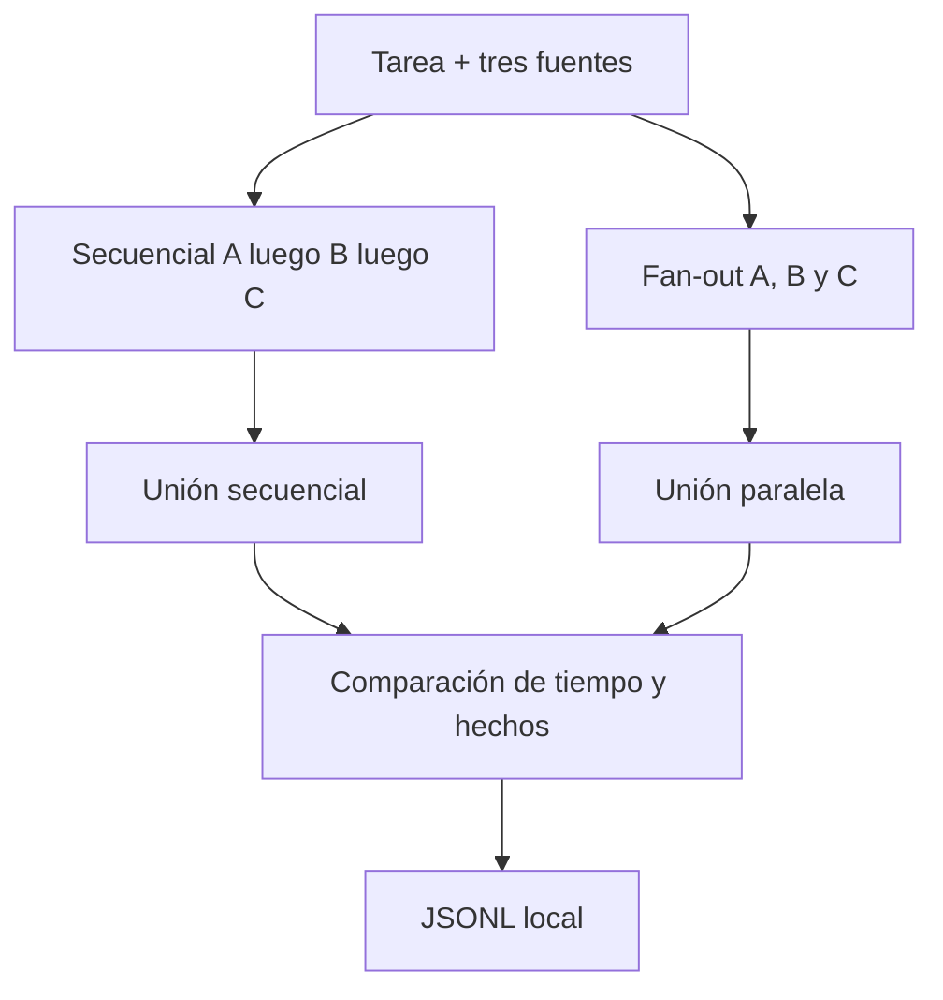

# Aprende a paralelizar sin perder procedencia

Este laboratorio responde una pregunta concreta: **¿cuándo el paralelismo reduce tiempo sin degradar coherencia ni agotar la VRAM?**

Al terminar podrás explicar y ejecutar estos cinco pasos:

1. Tres documentos independientes alimentan la misma tarea.
2. Una variante extrae A, luego B, luego C.
3. La otra lanza las tres ramas a la vez contra un modelo compartido.
4. El agregador espera resultados o un timeout explícito y no pinta como completa una rama fallida.
5. El dashboard muestra overlap, tiempos de pared y el JSONL sanitizado.

## Antes de empezar

- **Laboratorio previo:** [03-orchestration](../../../03-orchestration/docs/humano/README.md), donde
  los pasos dependen uno del otro y, por tanto, no pueden paralelizarse.
- **Software:** `uv`, Ollama con `qwen3.5:4b` y, para el dashboard, Node.js.
- **Vocabulario:** [fan-out / fan-in](../../../docs/humano/maestro/GLOSARIO.md#fan-out--fan-in),
  [concurrencia](../../../docs/humano/maestro/GLOSARIO.md#concurrencia-max_in_flight) y
  [speedup](../../../docs/humano/maestro/GLOSARIO.md#speedup).
- **Sin Ollama** puedes practicar el checker y la unión con los ejemplos 1 a 4 de
  [EXAMPLES.md](EXAMPLES.md).

## Mapa visual

## Cuatro conceptos

### Fan-out

Lanzar ramas que no se necesitan entre sí. Si B depende de A, no es este laboratorio.

### Fan-in

Esperar. El agregador no rellena huecos con imaginación. Timeout y fallo son estados visibles.

### Procedencia

Cada fila de la tabla recuerda `source_id`. Mezclar el precio de A con el horario de B sería un error de unión, no un detalle estético.

### Un modelo compartido

Este corte comparte pesos. Si Ollama atiende las tres llamadas en cola, el speedup se encoge. `PARALLEL_MAX_IN_FLIGHT=1` lo demuestra a propósito.

## Una analogía

Tres personas leen tres folletos distintos a la vez y luego juntan sus notas en una tabla. Si cada
una copia solo de su folleto y anota de cuál viene cada dato, el resultado es correcto y llega antes.
Pero si solo hay **una** fotocopiadora (un modelo compartido), las tres hacen cola y el ahorro
desaparece. Y si una persona se queda sin terminar, su columna queda vacía: nadie la rellena
adivinando.

## Recorrido guiado

1. Sigue [QUICKSTART.md](QUICKSTART.md).
2. Recorre los [ejemplos 1 a 3](EXAMPLES.md) para conocer el checker sin modelo.
3. Carga el caso `I-PARALLEL-002` en el dashboard.
4. Observa cómo las tres ramas paralelas pasan a `queued` antes de `running`.
5. Compara `wall_ms` y las fuentes completas.
6. Valida el JSONL y continúa con [EXERCISES.md](EXERCISES.md).

## Qué no hace

- No ejecuta varios modelos a la vez.
- No usa LangGraph, CrewAI ni AG2.
- No llama a APIs cloud ni tiene fallback pagado.
- No muestra el pensamiento privado del modelo.
- No conserva los documentos completos dentro del JSONL.

La arquitectura exacta está en [ARCHITECTURE.md](ARCHITECTURE.md).

## Dónde encaja en la ruta

- **Antes:** [03-orchestration](../../../03-orchestration/docs/humano/README.md).
- **Después:** [05-agent-loops](../../../05-agent-loops/docs/humano/README.md), donde un mismo paso se
  repite con presupuesto hasta alcanzar un umbral.
