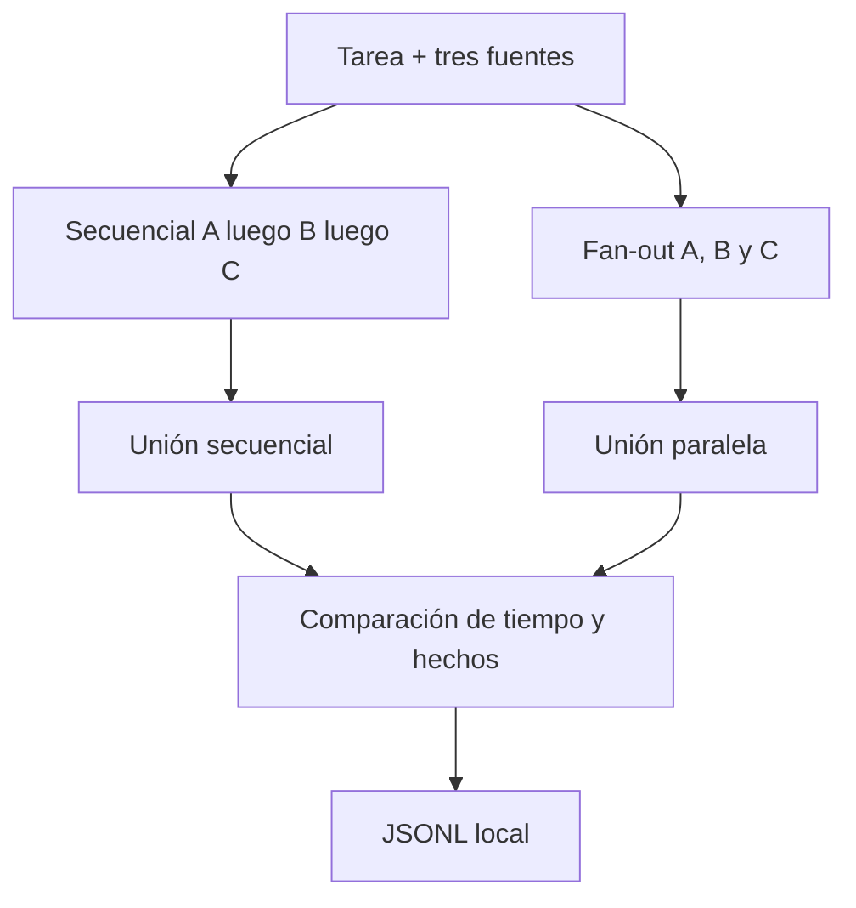

# Aprende a paralelizar sin perder procedencia

Este laboratorio responde una pregunta concreta: **¿cuándo el paralelismo reduce tiempo sin degradar coherencia ni agotar la VRAM?**

Al terminar podrás explicar y ejecutar estos cinco pasos:

1. Tres documentos independientes alimentan la misma tarea.
2. Una variante extrae A, luego B, luego C.
3. La otra lanza las tres ramas a la vez contra un modelo compartido.
4. El agregador espera resultados o un timeout explícito y no pinta como completa una rama fallida.
5. El dashboard muestra overlap, tiempos de pared y el JSONL sanitizado.

## Mapa visual

## Cuatro conceptos

### Fan-out

Lanzar ramas que no se necesitan entre sí. Si B depende de A, no es este laboratorio.

### Fan-in

Esperar. El agregador no rellena huecos con imaginación. Timeout y fallo son estados visibles.

### Procedencia

Cada fila de la tabla recuerda `source_id`. Mezclar el precio de A con el horario de B sería un error de unión, no un detalle estético.

### Un modelo compartido

Este corte comparte pesos. Si Ollama atiende las tres llamadas en cola, el speedup se encoge. `PARALLEL_MAX_IN_FLIGHT=1` lo demuestra a propósito.

## Recorrido guiado

1. Sigue [QUICKSTART.md](QUICKSTART.md).
2. Carga el caso `I-PARALLEL-002` en el dashboard.
3. Observa cómo las tres ramas paralelas pasan a `queued` antes de `running`.
4. Compara `wall_ms` y las fuentes completas.
5. Valida el JSONL y continúa con [EXERCISES.md](EXERCISES.md).

## Qué no hace

- No ejecuta varios modelos a la vez.
- No usa LangGraph, CrewAI ni AG2.
- No llama a APIs cloud ni tiene fallback pagado.
- No muestra el pensamiento privado del modelo.
- No conserva los documentos completos dentro del JSONL.

La arquitectura exacta está en [ARCHITECTURE.md](ARCHITECTURE.md).
