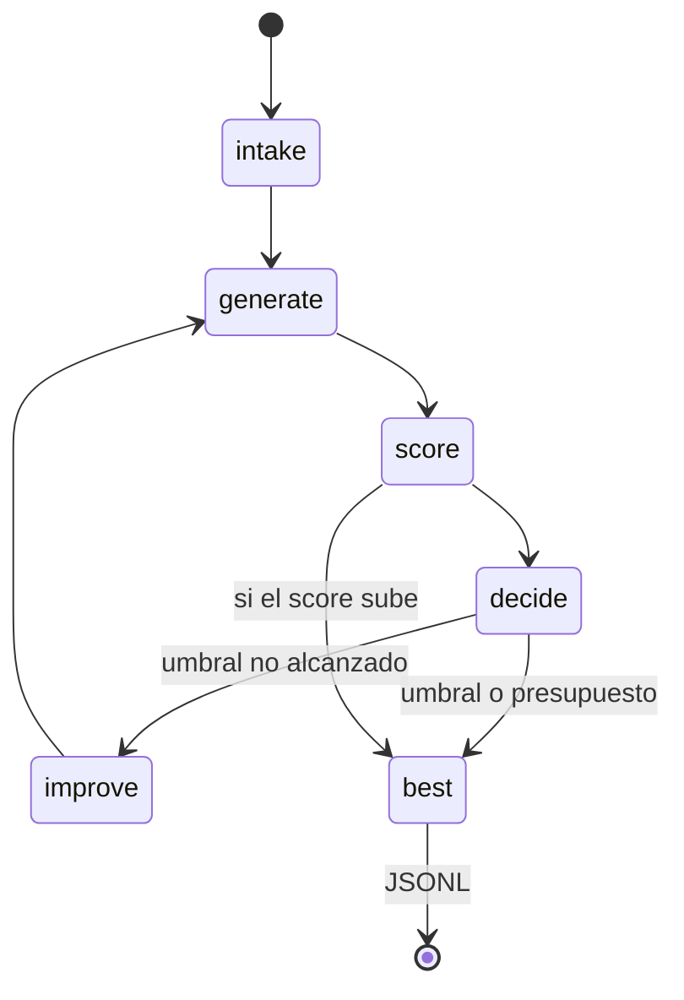

# Arquitectura explicada

## Corte vertical

Cada color del grafo corresponde a un evento `node.queued`, `node.started`, `node.completed` o `node.failed`. El frontend no inventa actividad. Los nodos *Generar*, *Puntuar* y *Mejorar* pueden volver a `queued` en la siguiente iteración.

## Componentes

| Componente | Entrada | Salida | Responsabilidad |
|---|---|---|---|
| `main.py` | HTTP | SSE y snapshot | Arranca la corrida y expone el estado |
| `engine.py` | Tarea y prompt | Iteraciones y mejor candidato | Presupuesto, parada y conservación del máximo |
| `ollama_client.py` | Mensajes | `ChatResult` | `POST /api/chat` local |
| `scoring.py` | Texto | Checks | Gate determinista de `I-LOOP-003` |
| `run_log.py` | Eventos | JSONL | Observabilidad sin texto crudo |
| `App.tsx` | Snapshot | Grafo React Flow | Visualización derivada de la API |

## Contratos

El mejorador debe devolver:

- `prompt`
- `rationale` opcional

El generador devuelve texto. El evaluador busca un objeto JSON con:

- `title` de al menos 8 caracteres
- `steps` con tres textos
- `limits` que mencionen Ollama o un límite local
- `stop_condition` con `/salir`, presupuesto o parada

Si el JSON del mejorador es inválido, cuenta como un error del presupuesto. El prompt anterior se conserva.

## Presupuesto

| Tope | Valor del caso |
|---|---|
| Iteraciones | 5 |
| Errores | 2 |
| Tiempo de pared | 180 s |
| Umbral | 5/5 |

Lo que ocurra primero detiene el loop. El motivo queda en `stop_reason`.

## Persistencia

No hay SQLite. El dashboard vive en memoria. La evidencia durable es `.local/runs/*.jsonl` y los artefactos en `.local/artifacts/<run_id>/`. El JSONL guarda conteos, hashes y una vista previa corta. El prompt y la salida completos solo viven en artefactos locales.

## Puertos

- API: `127.0.0.1:8015`
- UI: `127.0.0.1:5176`

Vite reenvía `/api` al backend. No hay CORS abierto a otros orígenes.

## Errores

Un fallo de transporte con Ollama incrementa el contador de errores. Al segundo, el loop para con `max_errors`. No hay reintentos ocultos ni fallback cloud.
