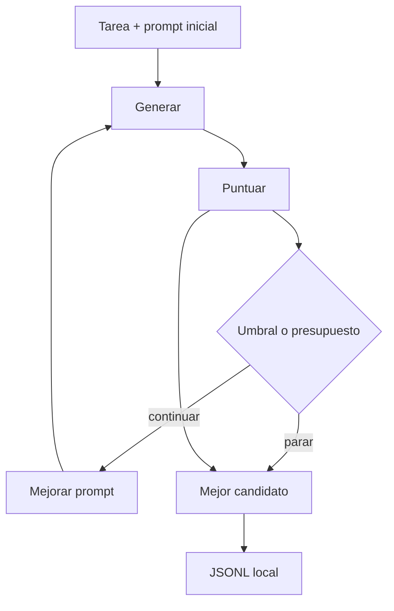

# Aprende a diseñar un loop que sabe parar

Este laboratorio responde una pregunta concreta: **¿cómo se diseña un ciclo que mejore resultados sin quedarse atrapado ni gastar recursos indefinidamente?**

Al terminar podrás explicar y ejecutar estos cinco pasos:

1. Se declara objetivo, score inicial, presupuesto y condición de parada.
2. Un prompt débil produce una salida.
3. Un evaluador en código cuenta cinco assertions estructurales.
4. Si no se alcanza el umbral, otro llamado reescribe el prompt.
5. Se conserva el mejor candidato, no necesariamente el último, y se explica por qué paró.

## Mapa visual

## Cuatro conceptos

### Declaración

Un loop sin presupuesto es un `while True`. Antes de la primera llamada hay que poder decir qué se busca, cuánto se puede gastar y cuándo se deja de intentar.

### Maker / checker

El modelo escribe. El código puntúa. Si el mismo agente se pone la nota, el ciclo se felicita a sí mismo.

### Mejor candidato

La última iteración puede empeorar el score. El laboratorio guarda el máximo visto, no el intento más reciente.

### Presupuesto

Cinco iteraciones, dos errores o tres minutos. El primero que se agote gana. El motivo de salida queda en el snapshot y en el JSONL.

## Recorrido guiado

1. Sigue [QUICKSTART.md](QUICKSTART.md).
2. Carga el caso `I-LOOP-003` en el dashboard.
3. Observa el score inicial del prompt débil.
4. Mira si el mejor candidato coincide con la última iteración.
5. Valida el JSONL y continúa con [EXERCISES.md](EXERCISES.md).

## Qué no hace

- No usa LangGraph ni OpenEvolve.
- No instala el CLI de `loop-engineering`; solo toma criterios de diseño.
- No llama a APIs cloud ni tiene fallback pagado.
- No muestra el pensamiento privado del modelo.
- No conserva el prompt ni la salida completa dentro del JSONL.

La arquitectura exacta está en [ARCHITECTURE.md](ARCHITECTURE.md).
