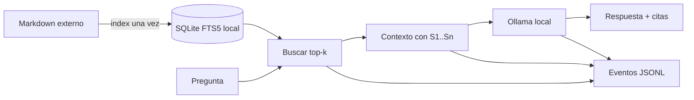

# Aprende RAG desde su forma más sencilla

## Objetivo

Este laboratorio permite ver qué cambia cuando un modelo recibe primero fragmentos recuperados
de una biblioteca local. La primera variante evita embeddings y frameworks: usa búsqueda de texto
completo de SQLite, construye un contexto pequeño y llama a Ollama.

Al terminar podrás distinguir tres piezas:

1. **Recuperar:** localizar fragmentos que comparten palabras con la pregunta.
2. **Aumentar:** adjuntar esos fragmentos, su procedencia y reglas de fidelidad.
3. **Generar:** pedir al modelo una respuesta con citas como `[S1]`.

## Antes de empezar

- **Laboratorio previo recomendado:** [02-single-agent](../../../02-single-agent/docs/humano/README.md),
  para entender que el modelo solo sabe lo que recibe en su contexto.
- **Software:** `uv`. Para `ask`, también Ollama con `qwen3.5:4b`; `index` y `search` no lo necesitan.
- **Vocabulario:** [RAG](../../../docs/humano/maestro/GLOSARIO.md#rag),
  [fragmento](../../../docs/humano/maestro/GLOSARIO.md#fragmento-chunk),
  [FTS5 y BM25](../../../docs/humano/maestro/GLOSARIO.md#fts5-y-bm25),
  [top-k](../../../docs/humano/maestro/GLOSARIO.md#top-k) y
  [abstención](../../../docs/humano/maestro/GLOSARIO.md#abstención).

## Una analogía

Imagina un bibliotecario que no ha leído los libros pero tiene un índice alfabético de palabras.
Le haces una pregunta, busca tus palabras en el índice, te trae las cuatro fichas con más
coincidencias y tú respondes leyendo **solo esas fichas**, citando de cuál sacaste cada dato. Si
ninguna ficha tiene tus palabras, te dice «no encontré nada» en lugar de inventar. Ese bibliotecario
es FTS5; quien lee las fichas es el modelo.

## Mapa visual

La flecha de importación es distinta de la consulta: el runtime no vuelve a leer los libros para
cada pregunta. Por eso el laboratorio puede copiarse junto con su `.local` o reconstruirse desde
otra carpeta Markdown sin depender de BL_Loops.

## Cómo puntúa BM25, sin fórmulas

- Cada palabra de la pregunta que aparece en un fragmento **suma**.
- Una palabra **rara** en el corpus suma más que una muy común: «presupuesto» distingue más que
  «antes».
- Aparecer en el **título** pesa más que aparecer en la sección, y esta más que en el texto
  (pesos 3, 2 y 1 en este laboratorio).
- SQLite expresa el resultado como un número negativo: **más negativo = más relevante**.

`naive-rag search` te deja ver esas puntuaciones antes de que intervenga el modelo.

## Recorrido sugerido

1. Sigue [QUICKSTART.md](QUICKSTART.md) para crear el índice y hacer una pregunta.
2. Recorre [EXAMPLES.md](EXAMPLES.md): top-k, prompt aumentado, citas y abstención.
3. Lee [ARCHITECTURE.md](ARCHITECTURE.md) mientras observas los tres pasos de la CLI.
4. Ejecuta los ejercicios de [EXERCISES.md](EXERCISES.md).
5. Usa el corpus sintético y la rúbrica de [EVALUATION.md](EVALUATION.md).
6. Si algo falla, consulta [TROUBLESHOOTING.md](TROUBLESHOOTING.md).

## Qué aprenderás también cuando falle

Una búsqueda léxica necesita palabras compartidas. Si preguntas mediante una paráfrasis que no
aparece en el corpus, FTS5 puede devolver cero resultados aunque exista una idea relacionada. Esa
limitación es el punto de comparación futuro con RAG vectorial, no un fallo que deba ocultarse.

## Dónde encaja en la ruta

- **Antes:** [05-agent-loops](../../../05-agent-loops/docs/humano/README.md) cierra la familia de
  coordinación de agentes.
- **Después:** [07-vector-rag](../../../07-vector-rag/docs/humano/README.md), que añade embeddings
  para encontrar paráfrasis y compara su ranking con el de este laboratorio.
