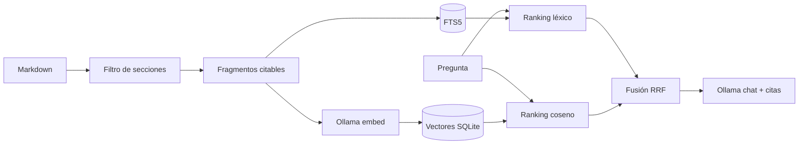

# RAG vectorial e híbrido, paso a paso

Este laboratorio responde una pregunta concreta: **¿cuándo la similitud semántica supera la
búsqueda por palabras?**

## Antes de empezar

- **Laboratorio previo:** [06-naive-rag](../../../06-naive-rag/docs/humano/README.md). Aquí se reutiliza
  su idea (recuperar → aumentar → generar) y se cambia solo el recuperador.
- **Software:** `uv` y Ollama con `qwen3-embedding:latest` (vectores) y `qwen3.5:4b` (respuestas).
- **Vocabulario:** [embedding](../../../docs/humano/maestro/GLOSARIO.md#embedding),
  [similitud coseno](../../../docs/humano/maestro/GLOSARIO.md#similitud-coseno),
  [búsqueda híbrida y RRF](../../../docs/humano/maestro/GLOSARIO.md#búsqueda-híbrida-y-rrf) y
  [recall@k](../../../docs/humano/maestro/GLOSARIO.md#recallk).
- **Sin Ollama** puedes recorrer el filtro de calidad, el coseno y la fusión RRF con los
  [ejemplos 1 a 4](EXAMPLES.md).

## Por qué existe

El RAG léxico es suficiente para búsquedas con palabras exactas y para este volumen. Falló, sin
embargo, cinco preguntas parafraseadas de ventas. Un spike local separó claramente un pasaje
semánticamente relevante de un distractor. También reveló que varias fichas contienen secciones de
Wikipedia ajenas al libro.

Por eso este laboratorio resuelve dos problemas distintos:

1. **Recall semántico:** encontrar ideas aunque cambien las palabras.
2. **Higiene:** no indexar secciones contaminadas ni fichas que solo contienen metadatos.

## Mapa visual

## Cuatro conceptos, sin matemáticas difíciles

### Embedding: coordenadas de significado

Imagina un mapa donde cada texto es un punto. Textos que *significan* algo parecido quedan cerca,
aunque usen palabras distintas: «entender al comprador» y «escucha diagnóstica» son vecinos;
«quarterback» queda lejos. Un modelo de embeddings calcula esas coordenadas. Aquí cada punto tiene
**768 coordenadas** (no 2), pero la idea es la misma.

### Similitud coseno: ¿apuntan hacia el mismo sitio?

Para comparar dos puntos se mide el ángulo entre sus flechas desde el origen. Ángulo pequeño →
coseno cercano a 1 → significado parecido. Ángulo recto → coseno 0 → sin relación. El
[ejemplo 2](EXAMPLES.md#ejemplo-2--coseno-con-vectores-de-juguete) lo calcula con vectores de tres
números.

### Búsqueda híbrida: dos opiniones mejor que una

FTS5 es excelente con nombres propios, títulos y términos exactos («SPIN Selling»). Los vectores son
mejores con paráfrasis. El modo híbrido pide su ranking a cada uno y los combina.

### RRF: votar por posiciones

No se pueden sumar una puntuación BM25 y un coseno: miden cosas distintas en escalas distintas. RRF
ignora los números y usa solo **el puesto** de cada fragmento en cada ranking:
`0.35 / (60 + puesto_léxico) + 0.65 / (60 + puesto_vectorial)`. Un fragmento que aparece arriba en
los dos rankings suma dos veces. El [ejemplo 3](EXAMPLES.md#ejemplo-3--fusión-rrf-paso-a-paso) lo
calcula paso a paso.

## Una analogía

Dos bibliotecarios buscan para ti. Uno busca por palabras en el índice (FTS5); el otro ha leído los
resúmenes y busca por tema (vectores). Cada uno te entrega su lista ordenada. Tú das más puntos a lo
que aparece arriba en cada lista y un poco más de peso al que busca por tema. Antes de todo esto, un
tercero retiró de los estantes las fichas manchadas con texto ajeno (el filtro de calidad).

## Recorrido guiado

1. Sigue [QUICKSTART.md](QUICKSTART.md) para indexar el corpus sintético.
2. Recorre los [ejemplos 1 a 4](EXAMPLES.md) sin Ollama para entender filtro, coseno y RRF.
3. Compara los tres modos con la misma paráfrasis ([ejemplo 5](EXAMPLES.md#ejemplo-5--tres-modos-una-paráfrasis-necesita-ollama)).
4. Genera una respuesta con `ask` y valida su JSONL.
5. Mide recall@5 con tus propias preguntas en [EXERCISES.md](EXERCISES.md).
6. Revisa el caso de [EVALUATION.md](EVALUATION.md) y, si algo falla, [TROUBLESHOOTING.md](TROUBLESHOOTING.md).

## Qué no hace

- No usa LangChain, una base vectorial externa ni un reranker.
- No convierte metadatos en conocimiento: si una ficha solo tiene metadatos, no hay nada que recuperar.
- No decide qué afirmación es verdadera; el filtro solo retira contaminación conocida.
- No guarda preguntas, fragmentos ni respuestas crudas en el JSONL.

La arquitectura exacta está en [ARCHITECTURE.md](ARCHITECTURE.md) y la decisión de diseño en
[METHODOLOGY.md](METHODOLOGY.md).

## Dónde encaja en la ruta

- **Antes:** [06-naive-rag](../../../06-naive-rag/docs/humano/README.md).
- **Después:** [08-graph-rag](../../../08-graph-rag/docs/humano/README.md), para preguntas cuya
  respuesta no está en un solo fragmento, y [09-agentic-rag](../../../09-agentic-rag/docs/humano/README.md),
  que reutiliza esta misma búsqueda híbrida como herramienta de un agente.
