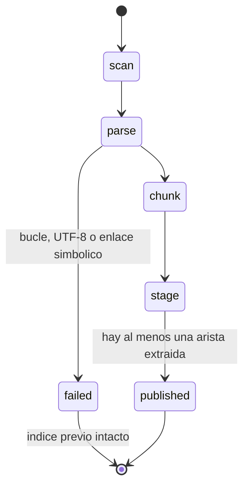

# Arquitectura

## Importación

Solo se aceptan triples con la forma `` `Sujeto` --predicado--> `Objeto` ``. El resto del Markdown
se fragmenta para la comparación léxica. Un documento puede no tener aristas; el corpus entero no.

## Consulta

1. Emparejar entidades de la pregunta con etiquetas del grafo, priorizando la etiqueta más larga.
2. Recorrer aristas salientes y entrantes hasta `GRAPH_RAG_MAX_HOPS` (3 por defecto).
3. Cada hop de la ruta es `extracted` y apunta a su línea de origen.
4. Si la ruta tiene dos o más hops, se muestra una arista `inferred` de extremo a extremo.
5. En modo `compare`, FTS5 lista fragmentos de la misma pregunta sin pretender reconstruir la ruta.

Las rutas se ordenan de más larga a más corta. Un salto recorrido al revés conserva su triple
original en la cita y en el diagrama Mermaid (`Ana_Ruiz -->|owns| AtlasCRM`); en la arista inferida,
cada salto inverso lleva el prefijo `^`, la notación de caminos inversos de SPARQL 1.1
(`MailRelay --^depends_on/^owns--> Luis Soto`).

Para decenas de nodos, BFS en SQLite es suficiente. Este diseño deberá revisarse si el corpus crece
varios órdenes de magnitud o si se autoriza un extractor no determinista.

## Seguridad

Fuente de solo lectura, escrituras confinadas, transporte local sin proxy ni redirección, sin
retry automático y JSONL sin contenido crudo. Las rutas siguen tratándose como datos no confiables
frente a inyección indirecta.
