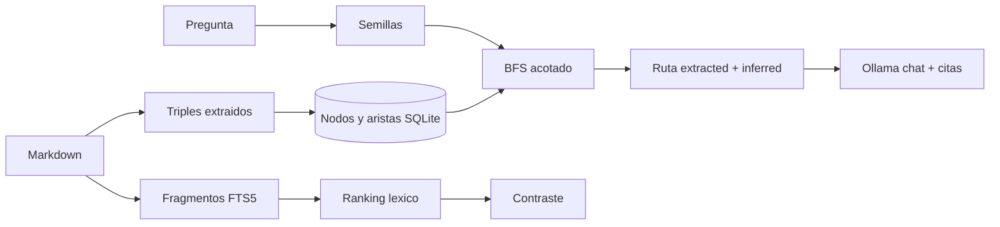

# Graph RAG, paso a paso

Este laboratorio responde una pregunta concreta: **¿cuándo las relaciones explícitas justifican el
costo de construir un grafo?**

## Antes de empezar

- **Laboratorios previos:** [06-naive-rag](../../../06-naive-rag/docs/humano/README.md) (búsqueda por
  palabras) y, si puedes, [07-vector-rag](../../../07-vector-rag/docs/humano/README.md) (búsqueda por
  significado). Aquí verás qué problema no resuelve ninguno de los dos.
- **Software:** `uv`. Para `ask`, también Ollama con `qwen3.5:4b`; `index` y `search` no lo necesitan.
- **Vocabulario:** [grafo, nodo y arista](../../../docs/humano/maestro/GLOSARIO.md#grafo-nodo-y-arista),
  [triple](../../../docs/humano/maestro/GLOSARIO.md#triple),
  [multi-hop](../../../docs/humano/maestro/GLOSARIO.md#multi-hop-saltos) y
  [arista extraída frente a inferida](../../../docs/humano/maestro/GLOSARIO.md#arista-extraída-frente-a-inferida).

## Por qué existe

El RAG léxico y el vectorial recuperan fragmentos **parecidos a la pregunta**. Fallan cuando la
respuesta no está en un solo pasaje: hay que unir un responsable, una aplicación y un proveedor que
viven en documentos distintos, y el documento que los une puede no parecerse en nada a la pregunta.



## Cinco conceptos

### Nodo, arista y triple

Un **nodo** es una entidad: una persona, una aplicación, una fecha. Una **arista** es una relación
con nombre entre dos nodos. Un **triple** la escribe completa: sujeto, predicado y objeto.

```text
`AtlasCRM` --depends_on--> `NortePay`
 sujeto       predicado      objeto
```

En este laboratorio los triples están escritos a mano en la sección «Relaciones» de cada Markdown.
Nadie los adivina: si no está escrito, no existe en el grafo.

### Semilla

El punto de partida del recorrido: una etiqueta de nodo que aparece en la pregunta. En «¿Qué fecha
de congelación afecta el proyecto de **Ana Ruiz**?» la semilla es `Ana Ruiz`.

### Salto (hop) y BFS

Cada arista recorrida es un **salto**. BFS (búsqueda en anchura) explora primero todo lo que está a
un salto, después a dos y así hasta el límite (`GRAPH_RAG_MAX_HOPS`, 3 por defecto). Puede recorrer
una flecha **al revés**: desde `AtlasCRM` llega a `Ana Ruiz` por `<--owns--`, lo que permite
responder «¿quién es dueño de…?».

### Arista extraída frente a inferida

- `extracted`: existe escrita en un documento y lleva cita de archivo y línea.
- `inferred`: resume una cadena de extraídas («Ana Ruiz → … → 2026-03-01»). Es una conclusión del
  recorrido, se muestra con su número de saltos y **nunca se guarda** como si fuera un hecho. Si un
  salto se recorrió al revés, su predicado lleva `^` (por ejemplo `^owns`).

### Contraste léxico

El modo `compare` muestra también el ranking FTS5 de la misma pregunta, para ver qué documentos
encontraría una búsqueda por palabras y cuáles se le escapan.

## Una analogía

Un detective tiene tres expedientes: uno dice quién lleva cada proyecto, otro de qué proveedor
depende cada proyecto y otro cuándo congela cambios cada proveedor. Ninguno responde solo a «¿qué
fecha afecta a Ana?». El detective une las fichas con hilo rojo: persona → proyecto → proveedor →
fecha. El grafo es ese tablero de hilos; cada hilo tiene la referencia del expediente del que salió.

## Recorrido guiado

1. Sigue [QUICKSTART.md](QUICKSTART.md) e indexa el corpus sintético.
2. Recorre los [ejemplos 1 a 6](EXAMPLES.md) sin Ollama: ruta de tres saltos, contraste léxico,
   saltos inversos, límite de saltos y abstención.
3. Genera una respuesta citada con `ask` ([ejemplo 7](EXAMPLES.md#ejemplo-7--generar-con-citas-necesita-ollama)).
4. Practica con [EXERCISES.md](EXERCISES.md) y revisa el caso de [EVALUATION.md](EVALUATION.md).

## Qué no hace

- No extrae relaciones de la prosa con un LLM: solo lee triples escritos.
- No resume comunidades ni calcula importancia de nodos como Microsoft GraphRAG.
- No usa Neo4j ni un servidor de grafos: para decenas de nodos, SQLite y BFS bastan.
- No valida que una arista sea verdadera; solo que está escrita y citada.

## Dónde encaja en la ruta

- **Antes:** [07-vector-rag](../../../07-vector-rag/docs/humano/README.md).
- **Después:** [09-agentic-rag](../../../09-agentic-rag/docs/humano/README.md), donde el modelo decide
  qué buscar mediante una herramienta.
