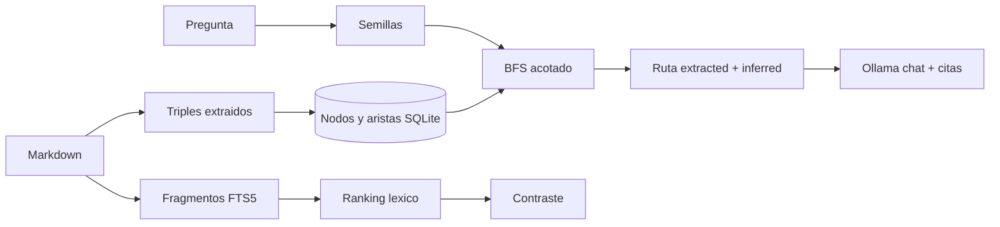

# Graph RAG, paso a paso

## Por qué existe

El RAG léxico y el vectorial recuperan fragmentos parecidos a la pregunta. Fallan cuando la
respuesta no está en un solo pasaje: hay que unir un responsable, una aplicación y un proveedor
que viven en documentos distintos.

Este laboratorio enseña esa diferencia con un grafo pequeño y visible.

Sigue [QUICKSTART.md](QUICKSTART.md) y después el caso en [EVALUATION.md](EVALUATION.md).
