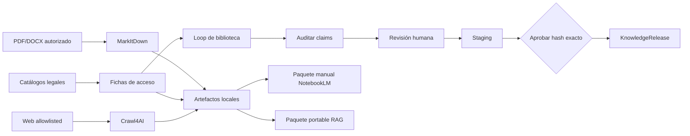

# Guía didáctica · Fábrica de conocimiento confiable de ventas

> Esta carpeta enseña el sistema. El runtime no lee ni necesita `docs/humano/`.

Este laboratorio convierte fuentes permitidas en evidencia auditable y, solo después de una
decisión humana, en un `KnowledgeRelease`. También ayuda a descubrir ediciones y accesos legales
sin confundir “está en Internet” con “se puede copiar”.

## Antes de empezar

- **Laboratorios previos recomendados:** [06-naive-rag](../../../06-naive-rag/docs/humano/README.md)
  (citas a archivo y líneas) y [09-agentic-rag](../../../09-agentic-rag/docs/humano/README.md), cuyo
  agente sufre exactamente el problema que este laboratorio ataca: un corpus débil.
- **Software:** `uv`. Ollama y la red son **opcionales** y están apagados por defecto.
- **Vocabulario:** [aprobación humana](../../../docs/humano/maestro/GLOSARIO.md#aprobación-humana-hitl),
  [huella](../../../docs/humano/maestro/GLOSARIO.md#huella-content_hash) e
  [inyección indirecta](../../../docs/humano/maestro/GLOSARIO.md#inyección-indirecta).

## Una analogía

Es la mesa de edición de un periódico. Cada dato llega con su fuente; el editor comprueba si sigue
vigente, si dos fuentes se contradicen, si el texto tiene permiso de uso y si alguien intentó colar
una orden disfrazada de noticia. Solo después, una persona firma **esta** edición concreta, y la
imprenta publica exactamente lo firmado.

## Los estados de una afirmación

| Estado | Significa | ¿Llega al release? |
|---|---|---|
| `candidate` | Recién extraída, sin verificar | No |
| `supported_single_source` / `corroborated` | Una fuente la sostiene / varias independientes | Solo tras aprobación |
| `human_approved` | Una persona la aprobó sobre su hash | Sí |
| `disputed` | Choca con otra afirmación | No, hasta resolver el conflicto |
| `outdated` / `superseded` | Fuera de su ventana de vigencia / reemplazada | No |
| `unsupported` | Afirmación sin método ni evidencia suficiente | No |
| `quarantined` | Derechos o procedencia dudosos | No |
| `rejected` | Inyección o contenido inadmisible | No, nunca |

El [ejemplo 3](EXAMPLES.md#ejemplo-3--nueve-afirmaciones-seis-estados) recorre seis de estos estados
con el corpus sintético.

## Dos carriles separados

El carril editorial publica claims. El carril de investigación crea Markdown, manifiestos y
metadatos para revisión; no publica por sí solo. Un PDF solo se conserva si el catálogo declara
descarga completa con derechos elegibles y evidencia.

## Qué está disponible

| Capacidad | Estado y límite |
|---|---|
| Corpus local | Markdown/TXT, determinista y read-only |
| PDF/DOCX | MarkItDown, solo desde inbox autorizado y con derechos explícitos |
| Catálogos | Open Library, Google Books, Gutenberg e Internet Archive |
| Loop de biblioteca | Inventario de fichas, dossier acotado y PDF legal opcional |
| Navegador | Una URL HTTPS allowlisted, `robots.txt` verificable, sin descargas ni sesión |
| NotebookLM | Paquete local; la subida es manual y `upload_performed=false` |
| RAG | JSONL de metadatos portable; sin conexión viva con otro laboratorio |
| Publicación | Claims aprobados → staging → aprobación posterior del hash → release |

## Decisiones humanas vigentes

- Se autorizó incorporar red, allowlist e investigación en inglés o español.
- Cualquier operador identificado puede aprobar un release desde el CLI.
- La jurisdicción está aprobada conceptualmente, pero falta escribir su valor concreto en
  `RESEARCH_JURISDICTION` o pasarlo al comando.
- El dominio real existe fuera del laboratorio, pero no fue identificado aquí; continúa como
  configuración, no como una suposición documental.

## Regla legal central

El uso educativo o no comercial no concede automáticamente permiso para copiar. La máquina
distingue `full_download`, `read_online`, `preview`, `borrow` y `catalog_only`; solo una
descarga completa con dominio público, licencia abierta o permiso explícito y evidencia de derechos
puede ser elegible. Préstamo, preview y copias sin evidencia no se bajan. El operador exporta
fichas a `docs/humano/Libros` solo con `--authorize-export`.

## Recorrido recomendado

1. Ejecuta [QUICKSTART.md](QUICKSTART.md) y la demo de [EXAMPLES.md](EXAMPLES.md).
2. Entiende los gates en [ARCHITECTURE.md](ARCHITECTURE.md).
3. Revisa decisiones y fuentes oficiales en [METHODOLOGY.md](METHODOLOGY.md).
4. Practica con [EXERCISES.md](EXERCISES.md).
5. Diagnostica con [TROUBLESHOOTING.md](TROUBLESHOOTING.md).
6. Aplica el gate de [EVALUATION.md](EVALUATION.md).

## Dónde encaja en la ruta

- **Antes:** [25-meeting-summarizer](../../../25-meeting-summarizer/docs/humano/README.md) o la familia
  RAG (06–09).
- **Después:** [14-local-code-hermes](../../../14-local-code-hermes/docs/humano/README.md), donde la
  misma disciplina de evidencia se aplica a un benchmark de clientes de programación.
