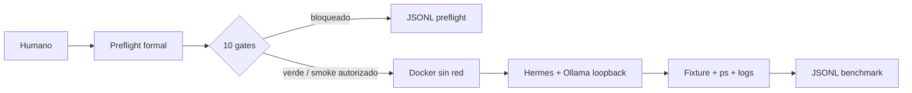

# Aprende a preparar y ejecutar un agente de código local

Este laboratorio enseña la separación entre diagnóstico, aislamiento y evaluación. El primer corte era solo preflight; ahora existe una corrida viva de Hermes contra Ollama, pero continúa separada del score oficial y de la comparación con otros clientes.

## Antes de empezar

- **Conocimientos:** haber recorrido al menos un laboratorio con traza JSONL (02 a 09) y saber qué es
  un commit de Git.
- **Software:** `uv` y Git bastan para el preflight y el fixture. La corrida viva necesita además
  Ollama con el alias `local-code-9b-64k`, Hermes y Docker.
- **Vocabulario:** [preflight](../../../docs/humano/maestro/GLOSARIO.md#preflight),
  [sandbox](../../../docs/humano/maestro/GLOSARIO.md#sandbox),
  [egress](../../../docs/humano/maestro/GLOSARIO.md#egress),
  [SHA](../../../docs/humano/maestro/GLOSARIO.md#sha) y
  [cohorte](../../../docs/humano/maestro/GLOSARIO.md#cohorte).

## Una analogía

Antes de cronometrar a tres corredores, el juez comprueba la pista, el reloj y que todos salgan de la
misma línea. Si algo no puede comprobarse, la carrera no se declara oficial: se corre como
entrenamiento. El preflight es esa inspección; el fixture es la prueba que todos deben superar; y
`comparable=false` es la etiqueta de «entrenamiento».

## Mapa visual

## Estados que debes distinguir

- `passed`: un gate pudo verificarse.
- `warning`: evidencia ausente en modo exploratorio; no es autorización.
- `blocked`: falta requisito, autoridad o aislamiento; no es un fallo de calidad del modelo.
- `failed`: el harness no pudo ejecutar su diagnóstico de forma confiable.
- `completed`: el proceso vivo terminó; aún puede no ser una solución correcta o comparable.

## Recorrido

1. Ejecuta la verificación hermética de [QUICKSTART.md](QUICKSTART.md) y los ejemplos 1 a 3 de [EXAMPLES.md](EXAMPLES.md).
2. Ejecuta el preflight exploratorio y valida su JSONL.
3. Revisa el alias, el perfil de Ollama, LM Studio, recursos y Git.
4. Ejecuta el benchmark solo con autorización y Docker disponible.
5. Examina el workspace y valida el JSONL de benchmark.
6. Explica por qué loopback, `--network=none` y firewall son evidencias distintas.
7. Usa [EXERCISES.md](EXERCISES.md) para repetir el razonamiento sin depender de servicios.

La estructura está en [ARCHITECTURE.md](ARCHITECTURE.md); decisiones, límites y cohortes están en [METHODOLOGY.md](METHODOLOGY.md).

## Dónde encaja en la ruta

- **Antes:** [13-sales-knowledge-curator](../../../13-sales-knowledge-curator/docs/humano/README.md) o
  cualquier laboratorio con trazas JSONL.
- **Después:** los clientes planificados `15-local-code-opencode` y `16-local-code-claude`, que
  repetirán el mismo fixture con el mismo SHA para poder comparar.
