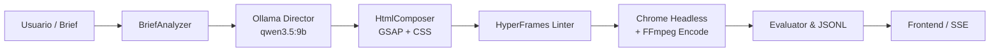

# Arquitectura: 22-hyperframes-video-studio

## Visión General del Sistema

El laboratorio desacopla la **dirección conceptual e inteligente** (manejada por Ollama en local) del **motor de renderizado determinista** (manejado por HyperFrames, Chromium y FFmpeg).

## Nodos y Estados de la Máquina

1. **`ANALYZING_BRIEF`**: Valida los parámetros del video (duración objetivo, resolución 1920x1080, framerate).
2. **`GENERATING_SCRIPT`**: Invoca al endpoint `/api/generate` de Ollama con un prompt en español para estructurar 5 escenas técnicas.
3. **`BUILDING_COMPOSITION`**: Construye el archivo `index.html` con atributos `data-start`, `data-duration` y líneas de tiempo GSAP registradas en `window.__timelines['main']`.
4. **`VALIDATING_LINT`**: Comprueba la integridad sintáctica de las etiquetas y selectores antes de lanzar el navegador.
5. **`RENDERING_VIDEO`**: Ejecuta `npx hyperframes render -o output.mp4` lanzando instancias en paralelo de Chromium Headless Shell que capturan cuadros exactos y los ensamblan con FFmpeg.
6. **`EVALUATING`**: Inspecciona el MP4 resultante con `ffprobe` para verificar duración real, resolución, tasa de cuadros y tamaño en disco, guardando la métrica en formato JSONL.
