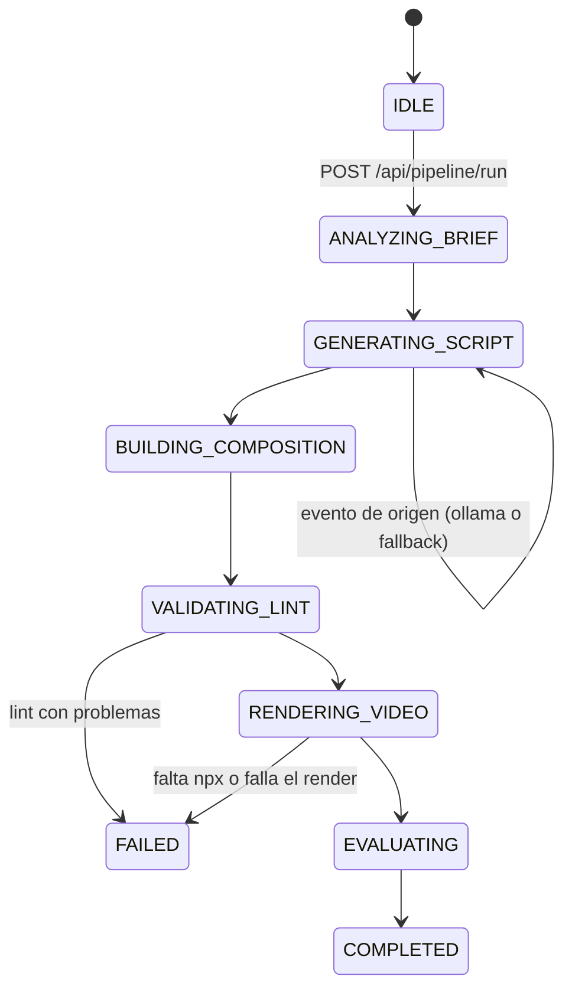

# Arquitectura: 22-hyperframes-video-studio

## Visión general

La **dirección** (Ollama propone el contenido) se separa del **render determinista** (HyperFrames
dibuja HTML fotograma a fotograma). Entre ambos hay dos controles: la línea de tiempo la fija el
estudio y un lint local revisa la composición antes de abrir Chrome.



## Nodos

| Nodo (`node`) | Estado | Qué hace |
|---|---|---|
| `BriefAnalyzer` | `ANALYZING_BRIEF` | Publica el brief validado |
| `OllamaDirector` | `GENERATING_SCRIPT` | Pide 5 escenas y publica su origen (`director_source`, `fallback_reason`) |
| `HtmlComposer` | `BUILDING_COMPOSITION` | Escribe `index.html`, `hyperframes.json` y `package.json` en `.local/workspace/` |
| `HyperFramesLinter` | `VALIDATING_LINT` | `lint_composition()`: un clip por escena, ninguno inesperado, ids únicos y tiempos contiguos |
| `ChromeFFmpegRenderer` | `RENDERING_VIDEO` | `npx --yes hyperframes@0.8.34 render -o <mp4>` con la telemetría desactivada |
| `QualityEvaluator` | `EVALUATING` | Mide con `ffprobe` y construye el `EvaluationRecord` |
| `PipelineGate` | `COMPLETED` | Cierra la corrida con evaluación y render |

## La composición

```html
<div id="root" data-composition-id="main" data-start="0" data-duration="15.0" ...>
  <div id="scene-1-intro" class="clip scene-card" data-start="0.0" data-duration="3.0" ...>
    ... titular, texto y <pre><code>fragmento escapado</code></pre> ...
  </div>
  ... cuatro escenas más ...
  <div class="brand-footer clip" data-start="0" data-duration="15.0">...</div>
  <div id="progress-indicator" class="timeline-bar clip" data-start="0" data-duration="15.0"></div>
</div>
<script>
  const tl = gsap.timeline({ paused: true });
  // entrada y salida de cada escena en su segundo exacto
  window.__timelines["main"] = tl;
</script>
```

HyperFrames abre la página en Chrome headless, mueve la línea de tiempo pausada a cada instante y
captura un fotograma; FFmpeg los une en el MP4. Como la línea de tiempo está pausada y se «busca»
(seek) a cada tiempo, el resultado no depende de la velocidad de la máquina.

## Texto del modelo como dato

| Valor | Riesgo | Tratamiento en `templates.py` |
|---|---|---|
| Titular, texto, badge, fragmento | Etiquetas HTML reales (`<div class="clip">`, `<script>`) | `html.escape` |
| `id` de la escena | Rompe el atributo o el selector GSAP `#id` | Lista blanca `^[A-Za-z][A-Za-z0-9_-]*$`; si no, `scene-N` |
| `accent_color` | CSS arbitrario dentro de `style` | Solo `#rrggbb`; si no, `#6366f1` |
| `bg_gradient` | `url(...)` u otras funciones CSS | Solo `linear-gradient(...)` con caracteres seguros |

## Contratos (`schemas.py`)

| Contrato | Campos clave | Límites |
|---|---|---|
| `VideoBrief` | `topic`, `target_duration`, `model` | 5 a 60 s; modelo local (sin `cloud`) |
| `SceneSpec` | `id`, `start_time`, `duration`, `headline`, `body`, `code_snippet`, colores | Tiempos fijados por el estudio |
| `RenderResult` | `duration`, `width`, `height`, `fps`, `success`, `error` | Medido con `ffprobe`; ceros sin medición |
| `EvaluationRecord` | `success`, `duration_actual`, `scenes_count`, `metrics` | Se exporta a JSONL |

## API

| Método y ruta | Uso | Respuestas |
|---|---|---|
| `GET /`, `/app.js`, `/styles.css` | Panel | 200 |
| `GET /api/status` | Ollama, `npx`, corrida activa, último render y evaluación | 200 |
| `POST /api/pipeline/run` | Lanza una corrida | 200; 409 si hay otra en curso; 422 si el brief no cumple el contrato |
| `GET /api/pipeline/events` | Eventos SSE | flujo continuo |
| `GET /api/composition/html` | Último HTML generado | 200; 404 antes de la primera corrida |
| `GET /api/video` | Último MP4 | 200; 404 sin render correcto |
| `POST /api/export` | Añade la última evaluación al JSONL | 200; 400 sin evaluación |

Si el brief no incluye `model`, se usa el del `.env`.

## Decisiones

- **Tiempos del estudio, contenido del modelo.** Un modelo puede proponer escenas solapadas; el
  video debe durar lo pedido. Por eso `start_time` y `duration` se calculan tras leer la respuesta.
- **Lint antes del render.** Abrir Chrome y renderizar cuesta segundos o minutos; el lint cuesta
  milisegundos y explica el problema. Habría detectado el «clip fantasma» que creaba el fragmento de
  la escena 2 antes de escapar el texto.
- **Una corrida a la vez.** Todas comparten `.local/workspace/`; la API responde 409 mientras otra
  está activa.
