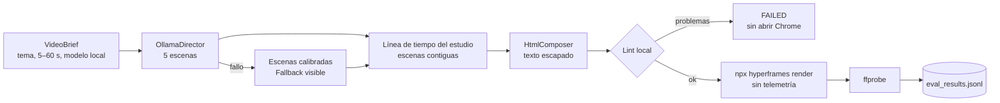

# Laboratorio 22: HyperFrames Video Studio

## Objetivo del laboratorio

Al terminar sabrás:

1. Explicar la diferencia entre video **generado por difusión** (cada fotograma lo inventa un modelo)
   y video **renderizado desde código** (HTML, CSS y una línea de tiempo que se dibujan siempre igual).
2. Repartir el trabajo: el modelo local propone el **contenido** de cinco escenas; el estudio fija la
   **línea de tiempo**, escribe la composición y la valida.
3. Leer una composición de HyperFrames: clips con `data-start` y `data-duration`, y una línea de
   tiempo GSAP registrada en `window.__timelines["main"]`.
4. Tratar el texto del modelo como dato: escapado HTML y listas blancas para ids y CSS.
5. Comprobar el resultado con un lint local antes del render y con `ffprobe` después.

## Antes de empezar

- **Laboratorios previos recomendados:** [01-prompt-agent-factory](../../../01-prompt-agent-factory/docs/humano/README.md)
  (contratos) y [09-agentic-rag](../../../09-agentic-rag/docs/humano/README.md) (fallback visible).
- **Software:** `uv`; para renderizar, Node.js 22+ (`node --version`) y FFmpeg con `ffprobe`. La
  primera vez, `npx` descarga HyperFrames y su Chrome headless. Ollama es opcional.
- **Vocabulario:** [composición y línea de tiempo](../../../docs/humano/maestro/GLOSARIO.md#composición-y-línea-de-tiempo),
  [render determinista](../../../docs/humano/maestro/GLOSARIO.md#render-determinista),
  [gate determinista](../../../docs/humano/maestro/GLOSARIO.md#gate-determinista),
  [fallback visible](../../../docs/humano/maestro/GLOSARIO.md#fallback-visible) y
  [ffprobe](../../../docs/humano/maestro/GLOSARIO.md#ffprobe).

## Una analogía

Es una obra de teatro con guion técnico. El modelo escribe los diálogos de cada escena; el director
de escena decide cuándo entra y sale cada actor (la línea de tiempo) y el regidor revisa el guion
técnico antes de la función (el lint). La función, ensayada así, sale igual todas las noches (el
render determinista).

## Mapa de la arquitectura

## Conceptos clave

| Concepto | Dónde lo ves |
|---|---|
| **Clip**: elemento con `class="clip"`, `data-start` y `data-duration` | `templates.py` |
| **Línea de tiempo del estudio**: cada escena dura `duración / 5` y empieza donde acaba la anterior | `ollama_client.py` |
| **Escapado HTML**: un fragmento `
` se muestra, no se ejecuta | `text()` en `templates.py` |
| **Lint local**: un clip por escena, ninguno inesperado, ids únicos, tiempos contiguos | `lint_composition()` |
| **Sin telemetría**: `HYPERFRAMES_NO_TELEMETRY=1` y `DO_NOT_TRACK=1` en el render | `renderer.py` |
| **Medir, no suponer**: sin `ffprobe`, ceros | `_probe_video()` |

## Recorrido didáctico

1. [Inicio rápido (QUICKSTART.md)](QUICKSTART.md): requisitos, demo, panel y pruebas.
2. [Ejemplos resueltos (EXAMPLES.md)](EXAMPLES.md): composición, lint, configuración y API.
3. [Arquitectura (ARCHITECTURE.md)](ARCHITECTURE.md): nodos, estados, contratos y API.
4. [Metodología (METHODOLOGY.md)](METHODOLOGY.md): fuentes, decisiones y límites.
5. [Ejercicios (EXERCISES.md)](EXERCISES.md): básico, intermedio y avanzado con soluciones.
6. [Diagnóstico (TROUBLESHOOTING.md)](TROUBLESHOOTING.md): Node, Chrome, FFmpeg, Ollama y lint.
7. [Evaluación (EVALUATION.md)](EVALUATION.md): criterios y formato JSONL.

## Dónde encaja en la ruta

- **Antes:** [14-local-code-hermes](../../../14-local-code-hermes/docs/humano/README.md) dentro del
  nivel 5; no es requisito.
- **Después:** [23-remotion-superpowers-studio](../../../23-remotion-superpowers-studio/docs/humano/README.md)
  hace lo mismo con React y fotogramas, y
  [24-open-generative-ai-studio](../../../24-open-generative-ai-studio/docs/humano/README.md) con
  storyboard y FFmpeg directo.
