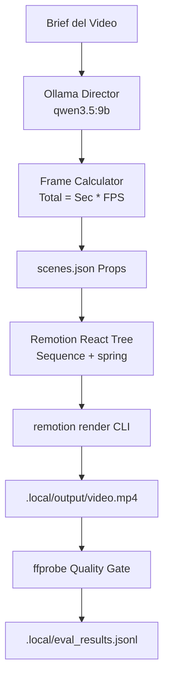

# Arquitectura: 23-remotion-superpowers-studio

## Pipeline de Remotion Superpowers

El laboratorio divide el proceso en dos capas:
1. **Capa Agéntica (Python + Ollama)**:
   - Recibe el brief del usuario.
   - Traduce los objetivos de duración a fotogramas discretos.
   - Genera los contenidos textuales, colores, badges y snippets.
   - Serializa la estructura hacia `scenes.json`.
2. **Capa de Renderizado (React + Remotion CLI)**:
   - `Root.tsx`: Define el canvas de resolución 1920x1080 y la duración global en fotogramas.
   - `MainComposition.tsx`: Encapsula cada escena en un componente `<Sequence>` de Remotion con su `from` y `durationInFrames`.
   - `SceneSequence.tsx`: Aplica física de resortes (`spring()`) y funciones de interpolación lineal (`interpolate()`).
   - `@remotion/cli`: Controla Chrome Headless para guardar fotogramas y compilar con FFmpeg.

