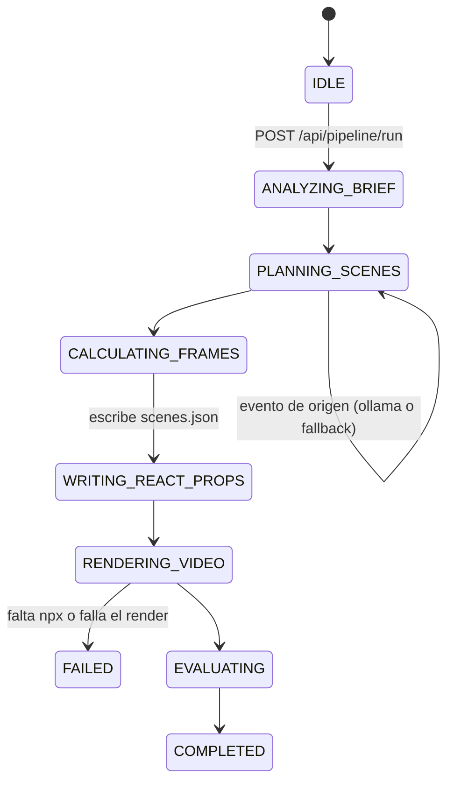

# Arquitectura: 23-remotion-superpowers-studio

## Dos capas

1. **Capa agéntica (Python + Ollama):** recibe el brief, pide contenido al modelo, calcula los
   fotogramas y escribe `scenes.json`.
2. **Capa de render (React + Remotion):** `Root.tsx` declara la composición, `MainComposition.tsx`
   coloca las escenas y `SceneSequence.tsx` las anima; `@remotion/cli` abre Chrome headless, captura
   cada fotograma y lo codifica con FFmpeg.



## Nodos

| Nodo (`node`) | Estado | Qué hace |
|---|---|---|
| `BriefAnalyzer` | `ANALYZING_BRIEF` | Publica el brief validado |
| `OllamaDirector` | `PLANNING_SCENES` | Pide 4 escenas y publica su origen |
| `FrameCalculator` | `CALCULATING_FRAMES` | `round(segundos × 30)` fotogramas, `total // 4` por escena |
| `ReactComposer` | `WRITING_REACT_PROPS` | Escribe `src/video_composition/scenes.json` con estilos validados |
| `RemotionCliRenderer` | `RENDERING_VIDEO` | `npx --yes -p @remotion/cli@4.0.523 remotion render ... --concurrency=4` |
| `QualityEvaluator` | `EVALUATING` | Mide con `ffprobe` (duración, fps, `nb_frames`) |
| `PipelineGate` | `COMPLETED` | Cierra la corrida |

## La composición React

```text
Root.tsx            <Composition id="MainVideo" width=1920 height=1080 fps=30
                                 durationInFrames = suma de scenes.json />
MainComposition.tsx   scenes.map → <Sequence from={startFrame} durationInFrames={...}>
                                     <SceneSequence scene=... />
SceneSequence.tsx       frame = useCurrentFrame()      // local: 0 al empezar cada escena
                        spring({frame, fps})           // entrada
                        interpolate(frame, [d-15, d])  // salida en los últimos 15 fotogramas
```

Cada fotograma se calcula solo a partir de su número: Remotion puede renderizar varios en paralelo
(`--concurrency=4`) o saltar a cualquiera (`remotion still --frame=N`) con el mismo resultado.

## Contratos (`schemas.py`)

| Contrato | Campos clave | Límites |
|---|---|---|
| `RemotionBrief` | `topic`, `target_duration`, `fps`, `width`, `height`, `model` | 4 a 60 s; solo 30 fps y 1920×1080 (los fija `Root.tsx`); modelo local |
| `RemotionScene` | `id`, `start_frame`, `duration_in_frames`, `headline`, `subheadline`, `code`, colores | Fotogramas calculados por el estudio |
| `RenderResult` | `duration`, `fps`, `total_frames`, `success`, `error` | Medido con `ffprobe`; ceros sin medición |
| `EvaluationRecord` | `success`, `total_frames`, `scenes_count`, `metrics` | Se exporta a JSONL |

## API

| Método y ruta | Uso | Respuestas |
|---|---|---|
| `GET /`, `/app.js`, `/styles.css` | Panel | 200 |
| `GET /api/status` | Ollama, `npx`, corrida activa, último render y evaluación | 200 |
| `POST /api/pipeline/run` | Lanza una corrida | 200; 409 si hay otra en curso; 422 si el brief no cumple el contrato |
| `GET /api/pipeline/events` | Eventos SSE | flujo continuo |
| `GET /api/scenes` | `scenes.json` actual | 200 |
| `GET /api/video` | Último MP4 | 200; 404 sin render correcto |
| `POST /api/export` | Añade la última evaluación al JSONL | 200; 400 sin evaluación |

## Decisiones

- **Datos tipados en lugar de código generado.** El modelo nunca escribe TSX. Así una respuesta mala
  puede dar un texto feo, pero no un componente que no compila.
- **Fotogramas del estudio.** Los calcula Python aunque el modelo proponga otros, para que la
  duración final coincida con la pedida.
- **`scenes.json` versionado.** Es la entrada que Remotion Studio necesita para abrir la composición
  en un clon recién descargado; por eso vive en `src/` y cada corrida lo reescribe.
- **Una corrida a la vez.** Todas comparten `scenes.json`; la API responde 409 mientras otra está
  activa.
