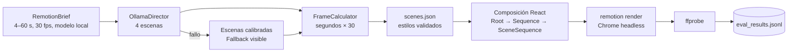

# Laboratorio 23: Remotion Superpowers Studio

## Objetivo del laboratorio

Al terminar sabrás:

1. Pensar un video como **fotogramas enteros**: 12 s a 30 fps son los fotogramas 0 a 359.
2. Leer una composición de Remotion: `<Composition>` fija tamaño, fps y duración; `<Sequence>` coloca
   cada escena en su fotograma; `useCurrentFrame()`, `spring()` e `interpolate()` calculan la
   animación a partir del número de fotograma.
3. Separar responsabilidades: el modelo propone el **contenido**; el estudio calcula los fotogramas y
   escribe datos tipados (`scenes.json`) que React dibuja.
4. Comprobar el resultado midiendo el MP4 con `ffprobe` y renderizando fotogramas sueltos.

## Antes de empezar

- **Laboratorios previos recomendados:** [22-hyperframes-video-studio](../../../22-hyperframes-video-studio/docs/humano/README.md)
  (composición en segundos) y [01-prompt-agent-factory](../../../01-prompt-agent-factory/docs/humano/README.md)
  (contratos).
- **Software:** `uv`; para renderizar, Node.js 22+ y `npm ci` en este laboratorio, más FFmpeg con
  `ffprobe`. Ollama es opcional.
- **Vocabulario:** [composición y línea de tiempo](../../../docs/humano/maestro/GLOSARIO.md#composición-y-línea-de-tiempo),
  [render determinista](../../../docs/humano/maestro/GLOSARIO.md#render-determinista),
  [fallback visible](../../../docs/humano/maestro/GLOSARIO.md#fallback-visible) y
  [ffprobe](../../../docs/humano/maestro/GLOSARIO.md#ffprobe).

## Una analogía

Un flipbook: cada página es un fotograma y el número de página decide qué se dibuja. El modelo
escribe el texto de cada capítulo; el estudio decide en qué página empieza y acaba cada uno, y
React dibuja cada página solo a partir de su número. Por eso puedes saltar a la página 100 y verla
igual que si hubieras pasado por las 99 anteriores.

## Mapa de la arquitectura

## Conceptos clave

| Concepto | Dónde lo ves |
|---|---|
| **Fotogramas totales** = `round(segundos × fps)`; cada escena recibe `total // 4` | `ollama_director.py` |
| **`<Composition>`**: id `MainVideo`, 1920×1080, 30 fps, duración = suma de escenas | `Root.tsx` |
| **`<Sequence from durationInFrames>`**: cada escena empieza en su fotograma | `MainComposition.tsx` |
| **`spring()` e `interpolate()`**: entrada y salida calculadas desde el fotograma | `SceneSequence.tsx` |
| **Datos, no código**: el modelo nunca escribe TSX; solo rellena `scenes.json` | `remotion_renderer.py` |
| **Medir, no suponer**: duración, fps y fotogramas leídos con `ffprobe` | `_probe_video()` |

## Recorrido didáctico

1. [Inicio rápido (QUICKSTART.md)](QUICKSTART.md): Python, Node.js, demo, Studio y panel.
2. [Ejemplos resueltos (EXAMPLES.md)](EXAMPLES.md): fotogramas, `scenes.json`, render real, fotograma
   suelto y API.
3. [Arquitectura (ARCHITECTURE.md)](ARCHITECTURE.md): nodos, estados, contratos y API.
4. [Metodología (METHODOLOGY.md)](METHODOLOGY.md): fuentes, licencias, decisiones y límites.
5. [Ejercicios (EXERCISES.md)](EXERCISES.md): básico, intermedio y avanzado con soluciones.
6. [Diagnóstico (TROUBLESHOOTING.md)](TROUBLESHOOTING.md): Node, Chrome, tipos y `scenes.json`.
7. [Evaluación (EVALUATION.md)](EVALUATION.md): criterios y formato JSONL.

## Dónde encaja en la ruta

- **Antes:** [22-hyperframes-video-studio](../../../22-hyperframes-video-studio/docs/humano/README.md).
- **Después:** [24-open-generative-ai-studio](../../../24-open-generative-ai-studio/docs/humano/README.md),
  que valida un storyboard contra un contrato y renderiza con FFmpeg directo.
