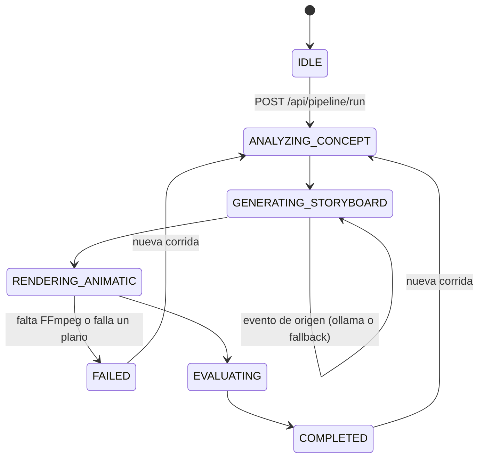
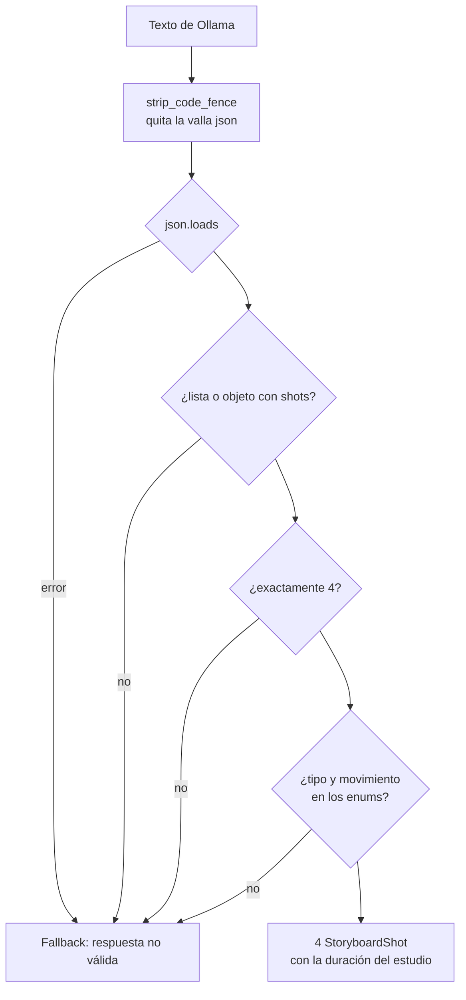

# Arquitectura: 24-open-generative-ai-studio

## Visión general

El estudio separa tres responsabilidades: **proponer** (el modelo local), **validar** (contratos
Pydantic y `parse_shots()`) y **producir y medir** (FFmpeg y `ffprobe`). El orquestador une las tres y
publica cada paso como evento SSE.



## Nodos

| Nodo (evento `node`) | Estado | Qué hace | Salida |
|---|---|---|---|
| `ConceptAnalyzer` | `ANALYZING_CONCEPT` | Publica el proyecto recibido | `data.project` |
| `StoryboardStudio` | `GENERATING_STORYBOARD` | Pide 4 planos a Ollama y valida el contrato; si falla, usa planos calibrados | Evento con `data.director_source` y, si aplica, `data.fallback_reason` |
| `AnimaticEngine` | `RENDERING_ANIMATIC` | Un segmento MP4 por plano con `drawtext`, luego `concat` sin recodificar | `data.shots`; en fallo, `RenderResult` con `error` |
| `QualityEvaluator` | `EVALUATING` | Mide con `ffprobe` y construye el `EvaluationRecord` | `data` con el `RenderResult` |
| `PipelineGate` | `COMPLETED` | Cierra la corrida | `data.eval` y `data.render` |

El Prompt Studio es independiente del pipeline: `POST /api/prompt/expand` responde de inmediato, sin
eventos ni estados.

## Contratos principales (`schemas.py`)

| Contrato | Campos clave | Límites |
|---|---|---|
| `StoryboardProject` | `title`, `narrative_concept`, `total_duration_target`, `model` | 4 a 60 s; sinopsis de 10 a 600 caracteres; modelo local |
| `StoryboardShot` | `shot_type`, `camera_movement`, `duration_seconds`, `headline`, `prompt_expansion`, `lighting`, `accent_color` | `duration_seconds >= 1`; tipos y movimientos limitados a sus enums |
| `PromptExpansionRequest` | `raw_idea`, `style`, `model` | idea de 3 a 500 caracteres; modelo local |
| `RenderResult` | `duration`, `width`, `height`, `fps`, `shots_count`, `success`, `error` | Medido con `ffprobe`; ceros si no hay medición |
| `EvaluationRecord` | `success`, `duration_actual`, `duration_expected`, `metrics` | Se exporta a JSONL |

## Cómo se lee la respuesta del modelo



Las comparaciones de enums no distinguen mayúsculas (`close-up` vale) y la duración de cada plano la
calcula el estudio: `total_duration_target / 4`.

## El filtergraph de un plano

Cada plano es una entrada `lavfi` de FFmpeg:

```text
color=c=0x0a0f1d:s=1920x1080:d=3.0:r=30,
drawbox=x=80:y=80:w=1760:h=920:color=0x38bdf8@0.3:t=2,
drawtext=text='PLANO 1\: Extreme Wide Shot | Slow Pan Right':expansion=none:fontfile='...':fontcolor=0x38bdf8:fontsize=28:x=120:y=120,
... (titular, luz, etiqueta del prompt, prompt y pie)
```

Reglas de seguridad del texto (`drawtext_value()`):

| Carácter | Problema | Tratamiento |
|---|---|---|
| `'` | Cerraría `text='...'` | Se sustituye por `’` |
| `:` | Separa opciones de `drawtext` | Se escapa como `\:` |
| `\` | Iniciaría un escape | Se sustituye por `/` |
| `%` | Expansión de texto de drawtext | Literal gracias a `expansion=none` |
| Saltos de línea | Romperían la línea | Se compactan a un espacio |

La fuente se elige con `ANIMATIC_FONT_FILE` o con la primera de `FONT_CANDIDATES`. Su ruta también se
escapa: `C:/Windows/Fonts/arial.ttf` se escribe `C\:/Windows/Fonts/arial.ttf`.

## API

| Método y ruta | Uso | Respuestas |
|---|---|---|
| `GET /` , `/app.js`, `/styles.css` | Panel | 200 |
| `GET /api/status` | Estado comprobado: Ollama, FFmpeg, ffprobe, corrida activa, último render | 200 |
| `POST /api/pipeline/run` | Lanza una corrida en segundo plano | 200; 409 si hay otra en curso; 422 si el proyecto no cumple el contrato |
| `GET /api/pipeline/events` | Eventos SSE (`data: {...}`) | flujo continuo |
| `GET /api/storyboard` | Últimos planos y su origen | 200; 404 antes de la primera corrida |
| `POST /api/prompt/expand` | Prompt Studio | 200 con `source`, `fallback_reason`, `model` y `result`; 422 |
| `GET /api/video` | Último MP4 | 200; 404 si no hay render correcto |
| `POST /api/export` | Añade la última evaluación al JSONL | 200; 400 si no hay evaluación |

Si la petición no incluye `model`, la API usa el modelo del `.env`, no el valor por defecto del
esquema.

## Decisiones

- **Una corrida a la vez:** todas comparten `.local/workspace/`; una segunda corrida simultánea
  mezclaría segmentos. Por eso la API responde 409 y guarda la referencia de la tarea activa.
- **Segmentos y `concat -c copy`:** cada plano se codifica una vez y la unión no recodifica, así un
  plano fallido se detecta antes de ensamblar.
- **Estado en memoria:** el último storyboard y render viven en el proceso. Al reiniciar el servidor,
  el panel empieza vacío; el MP4 y el JSONL siguen en `.local/`.
