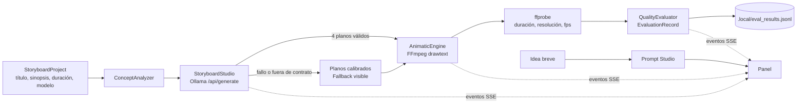

# Laboratorio 24: Open Generative AI Studio

## Objetivo del laboratorio

Al terminar sabrás:

1. Convertir una sinopsis en un **storyboard** de cuatro planos con tipo de plano, movimiento de
   cámara, iluminación, color de acento y prompt para generadores de imagen o video.
2. **Validar** la respuesta del modelo contra un contrato antes de usarla: número de planos, valores
   permitidos y JSON bien formado. Si no cumple, el respaldo calibrado se activa y lo dice.
3. Preparar texto para el filtro `drawtext` de FFmpeg sin que una comilla o un `:` rompan el comando.
4. Renderizar un **animatic** MP4 y **medirlo** con `ffprobe` en lugar de suponer su duración.
5. Expandir una idea breve con el **Prompt Studio** y reconocer cuándo el resultado viene del modelo y
   cuándo de una plantilla.

## Antes de empezar

- **Laboratorios previos recomendados:** [01-prompt-agent-factory](../../../01-prompt-agent-factory/docs/humano/README.md)
  (contratos) y [09-agentic-rag](../../../09-agentic-rag/docs/humano/README.md) (fallback visible).
  Los estudios [22](../../../22-hyperframes-video-studio/docs/humano/README.md) y
  [23](../../../23-remotion-superpowers-studio/docs/humano/README.md) enseñan otras formas de producir
  video con código; no hace falta haberlos hecho.
- **Software:** `uv`, FFmpeg con `ffprobe` en el `PATH`. Ollama con `qwen3.5:9b` o `qwen3.5:4b` es
  opcional.
- **Vocabulario:** [contrato](../../../docs/humano/maestro/GLOSARIO.md#contrato),
  [fallback visible](../../../docs/humano/maestro/GLOSARIO.md#fallback-visible),
  [SSE](../../../docs/humano/maestro/GLOSARIO.md#sse),
  [storyboard y animatic](../../../docs/humano/maestro/GLOSARIO.md#storyboard-plano-y-animatic) y
  [filtergraph](../../../docs/humano/maestro/GLOSARIO.md#filtergraph-y-escapado).

## Una analogía

Antes de rodar, un equipo de cine dibuja el storyboard y monta un animatic: viñetas con la duración
de cada plano para comprobar el ritmo. Aquí el «dibujante» es un modelo local, pero el jefe de
producción (el contrato) revisa cada viñeta: si faltan planos o el tipo de plano no existe, la
descarta y usa el storyboard de ensayo, avisando a todo el equipo.

## Mapa de la arquitectura

## Conceptos clave

| Concepto | Dónde lo ves |
|---|---|
| **Contrato de salida**: el modelo debe devolver exactamente 4 planos con valores permitidos | `parse_shots()` en `storyboard_engine.py` |
| **Duración fijada por el estudio**: la suma de planos coincide con lo pedido aunque el modelo invente otra | `duration_seconds` de cada plano |
| **Escapado para FFmpeg**: `:` → `\:`, comilla → `’`, barra invertida → `/` | `drawtext_value()` |
| **Color validado**: un color inventado cae al acento base `#6366f1` | `safe_hex_color()` |
| **Fallo explícito**: si FFmpeg no genera un plano, la corrida falla y dice cuál | `render_animatic()` |
| **Medir, no suponer**: duración y resolución salen de `ffprobe`; sin medición, ceros | `_probe_video()` |
| **Fallback visible**: el origen (`ollama` o `fallback`) viaja en eventos, panel y JSONL | `director_source` |

## Recorrido didáctico

1. [Inicio rápido (QUICKSTART.md)](QUICKSTART.md): instalación, demo, panel y pruebas.
2. [Ejemplos resueltos (EXAMPLES.md)](EXAMPLES.md): salidas reales de la demo, la API y los contratos.
3. [Arquitectura (ARCHITECTURE.md)](ARCHITECTURE.md): nodos, estados, contratos y API.
4. [Metodología (METHODOLOGY.md)](METHODOLOGY.md): fuentes, decisiones y límites.
5. [Ejercicios (EXERCISES.md)](EXERCISES.md): básico, intermedio y avanzado con soluciones.
6. [Diagnóstico (TROUBLESHOOTING.md)](TROUBLESHOOTING.md): FFmpeg, fuentes, Ollama y puertos.
7. [Evaluación (EVALUATION.md)](EVALUATION.md): criterios de aprobado y formato JSONL.

## Dónde encaja en la ruta

- **Antes:** [23-remotion-superpowers-studio](../../../23-remotion-superpowers-studio/docs/humano/README.md),
  donde el video se compone con React y se renderiza fotograma a fotograma.
- **Después:** es el último estudio de la
  [ruta de aprendizaje](../../../docs/humano/maestro/RUTA_DE_APRENDIZAJE.md). Compara los JSONL de 22,
  23 y 24: los tres registran `director_source` y `duration_measured`.
