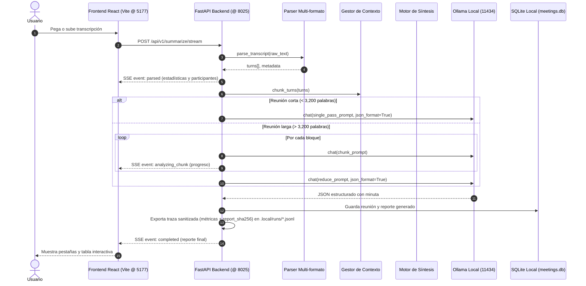

# Arquitectura Técnica · Laboratorio 25 (`25-meeting-summarizer`)

Este documento detalla la estructura interna, flujo de datos, partición de contexto y contratos de la herramienta.

## 1. Diagrama de flujo de datos

## 2. Componentes del sistema

### 2.1 Parser Multi-formato (`parser.py`)
No asume un formato rígido. Mediante expresiones regulares compuestas, reconoce:
- Transcripciones con timestamps y corchetes: `[00:01:23] Nombre: Texto`.
- Transcripciones directas: `01:23 Nombre: Texto`.
- Formato Zoom WebVTT: bloques cue con `00:00:01.000 --> 00:00:04.000`.
- Formato Microsoft Teams: bloques de 2 líneas (Nombre y hora en línea 1, texto en línea 2).
- Texto plano: párrafos continuos sin hablantes explícitos.

Calcula métricas:
- Número total de palabras.
- Total de turnos.
- Conteo de intervenciones por participante.
- Duración de la videollamada (diferencia entre primer y último timestamp, o estimación a 130 palabras por minuto).

### 2.2 Gestor de Contexto y Partición (`chunker.py`)
Los modelos locales tienen ventanas de contexto específicas. Aunque `qwen3.5:9b` soporta ventanas amplias (16k/32k), una reunión de más de 45-60 minutos genera miles de palabras:
- **Límite seguro por bloque**: 3,200 palabras (~4,500 tokens).
- **Solapamiento (*Overlap*)**: 250 palabras del bloque anterior para evitar perder el hilo argumental o acuerdos cortados al final del turno.
- **Estrategia Map-Reduce**: Los resúmenes parciales de cada bloque se envían a un prompt de reducción final que extrae las decisiones globales y consolida la tabla de compromisos.

### 2.3 Motor de Extracción y Prompts (`prompts.py` y `summarizer.py`)
- Emite un contrato JSON estrictamente tipado mediante el flag `format="json"` de Ollama.
- El contrato exige:
  - `executive_summary`: 2 a 4 párrafos concisos.
  - `topics`: lista de objetos `{ topic, summary, participants_involved }`.
  - `decisions`: lista de objetos `{ decision, rationale, impact }`.
  - `action_items`: lista de objetos `{ task, assignee, deadline, priority, context }`.
  - `open_questions`: lista de dudas o riesgos abiertos.
  - `email_followup`: texto Markdown listo para compartir.

### 2.4 Persistencia Local (`storage.py`)
- Base de datos SQLite embebida en `.local/data/meetings.db`.
- Almacena reuniones, resúmenes históricos e historial de preguntas y respuestas.
- Manejo seguro de conexiones mediante context manager con cierre forzado de descriptores de archivo en Windows.

### 2.5 Corridas deterministas y evaluación (`run_log.py`)
- Cada resumen ejecutado genera un archivo en `.local/runs/run_<meeting_id>_<hash>.jsonl`.
- Contiene métricas cuantificables (tiempo de procesamiento, conteo de decisiones, conteo de tareas) permitiendo la importación en el comparador central de BL_Loops.
