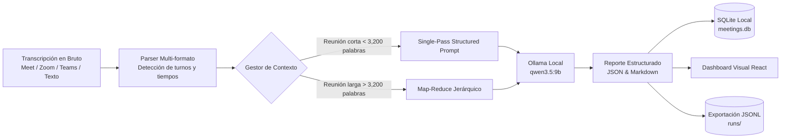

# Laboratorio 25: Resúmenes Inteligentes de Videollamadas

## Objetivo del laboratorio

Este laboratorio enseña a construir una herramienta integral, local y visual para procesar transcripciones generadas en videollamadas de equipo (Google Meet, Zoom, Microsoft Teams, tl;dv, etc.) y transformarlas en:

1. **Resumen Ejecutivo (TL;DR)**: Síntesis de alto nivel del propósito y contexto del encuentro.
2. **Ejes Temáticos**: Agrupación estructurada de lo discutido y posturas de los participantes.
3. **Decisiones Clave**: Lista explícita de acuerdos aprobados o descartados.
4. **Matriz de Compromisos y Tareas (Action Items)**: Tabla con responsable, plazo acordado y prioridad.
5. **Minuta Lista para Enviar**: Redacción en Markdown para compartir inmediatamente por Slack, Teams o Correo.
6. **Asistente de Preguntas y Respuestas (Q&A)**: Capacidad interactiva de consultar detalles sobre la conversación.

## Antes de empezar

- **Laboratorios previos recomendados:** [02-single-agent](../../../02-single-agent/docs/humano/README.md)
  (contexto y memoria) y [06-naive-rag](../../../06-naive-rag/docs/humano/README.md) (fidelidad a las
  fuentes). Aquí la «fuente» es la transcripción.
- **Software:** `uv`; Ollama con `qwen3.5:9b` o `qwen3.5:4b` para resumir; Node.js para el dashboard.
- **Vocabulario:** [map-reduce](../../../docs/humano/maestro/GLOSARIO.md#map-reduce),
  [temperatura](../../../docs/humano/maestro/GLOSARIO.md#temperatura),
  [alucinación](../../../docs/humano/maestro/GLOSARIO.md#alucinación) y
  [sanitización](../../../docs/humano/maestro/GLOSARIO.md#sanitización).
- **Sin Ollama** puedes recorrer el parser y el plan de bloques con `meeting-summarizer parse`.

## Una analogía

Es la persona que toma acta en una reunión. Primero pasa a limpio quién habló y cuándo (parser).
Si la reunión es muy larga, la resume por partes y luego une los resúmenes (map-reduce). Y escribe
solo lo acordado: si alguien dijo «alguien debería…», en el acta queda «sin asignar», no el nombre de
quien parecía más disponible.

## Mapa de la arquitectura

## Principios clave

- **Privacidad y Soberanía Total**: Las transcripciones de reuniones corporativas suelen contener datos estratégicos, acuerdos de negocio o nombres de clientes. Al utilizar Ollama local (`127.0.0.1:11434`), ningún dato sale de la máquina ni viaja a servicios en la nube, y la traza JSONL solo guarda recuentos y una huella del informe.
- **Tolerancia a Formatos No Homogéneos**: Las herramientas de videoconferencia exportan transcripciones en formatos muy distintos (WebVTT con flechas de tiempo, corchetes, minutos sin segundos o texto plano). El parser normaliza todo a contratos Pydantic consistentes.
- **Prevención de Pérdida de Contexto**: Para reuniones de 45 a 90 minutos, el particionador divide la transcripción con solapamiento (*overlap*) para evitar cortar frases o compromisos a la mitad.

## Recorrido didáctico

1. [Inicio rápido (QUICKSTART.md)](QUICKSTART.md): Comandos PowerShell para ejecutar backend y frontend.
2. [Ejemplos resueltos (EXAMPLES.md)](EXAMPLES.md): formatos, plan de bloques, configuración segura y una clave de corrección.
3. [Arquitectura técnica (ARCHITECTURE.md)](ARCHITECTURE.md): Nodos, estados, contratos Pydantic y estrategia de chunking.
4. [Metodología (METHODOLOGY.md)](METHODOLOGY.md): Criterios de diseño y buenas prácticas con LLMs locales.
5. [Ejercicios prácticos (EXERCISES.md)](EXERCISES.md): Retos básico, intermedio y avanzado.
6. [Diagnóstico y problemas (TROUBLESHOOTING.md)](TROUBLESHOOTING.md): Errores comunes y soluciones.
7. [Evaluación y métricas (EVALUATION.md)](EVALUATION.md): Criterios para medir la precisión de la extracción.

## Dónde encaja en la ruta

- **Antes:** la familia RAG (06–09), que enseña a responder con evidencia citada.
- **Después:** [13-sales-knowledge-curator](../../../13-sales-knowledge-curator/docs/humano/README.md),
  donde la evidencia pasa por revisión humana antes de publicarse.
