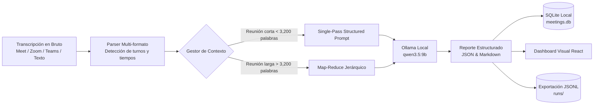

# Laboratorio 25: Resúmenes Inteligentes de Videollamadas

## Objetivo del laboratorio

Este laboratorio enseña a construir una herramienta integral, local y visual para procesar transcripciones generadas en videollamadas de equipo (Google Meet, Zoom, Microsoft Teams, tl;dv, etc.) y transformarlas en:

1. **Resumen Ejecutivo (TL;DR)**: Síntesis de alto nivel del propósito y contexto del encuentro.
2. **Ejes Temáticos**: Agrupación estructurada de lo discutido y posturas de los participantes.
3. **Decisiones Clave**: Lista explícita de acuerdos aprobados o descartados.
4. **Matriz de Compromisos y Tareas (Action Items)**: Tabla con responsable, plazo acordado y prioridad.
5. **Minuta Lista para Enviar**: Redacción en Markdown para compartir inmediatamente por Slack, Teams o Correo.
6. **Asistente de Preguntas y Respuestas (Q&A)**: Capacidad interactiva de consultar detalles sobre la conversación.

## Mapa de la arquitectura

## Principios clave

- **Privacidad y Soberanía Total**: Las transcripciones de reuniones corporativas suelen contener datos estratégicos, acuerdos de negocio o nombres de clientes. Al utilizar Ollama local (`127.0.0.1:11434`), ningún dato sale de la máquina ni viaja a servicios en la nube.
- **Tolerancia a Formatos No Homogéneos**: Las herramientas de videoconferencia exportan transcripciones en formatos muy distintos (WebVTT con flechas de tiempo, corchetes, minutos sin segundos o texto plano). El parser normaliza todo a contratos Pydantic consistentes.
- **Prevención de Pérdida de Contexto**: Para reuniones de 45 a 90 minutos, el particionador divide la transcripción con solapamiento (*overlap*) para evitar cortar frases o compromisos a la mitad.

## Recorrido didáctico

1. [Inicio rápido (QUICKSTART.md)](QUICKSTART.md): Comandos PowerShell para ejecutar backend y frontend.
2. [Arquitectura técnica (ARCHITECTURE.md)](ARCHITECTURE.md): Nodos, estados, contratos Pydantic y estrategia de chunking.
3. [Metodología (METHODOLOGY.md)](METHODOLOGY.md): Criterios de diseño y buenas prácticas con LLMs locales.
4. [Ejercicios prácticos (EXERCISES.md)](EXERCISES.md): Retos básico, intermedio y avanzado.
5. [Diagnóstico y problemas (TROUBLESHOOTING.md)](TROUBLESHOOTING.md): Errores comunes y soluciones.
6. [Evaluación y métricas (EVALUATION.md)](EVALUATION.md): Criterios para medir la precisión de la extracción.
