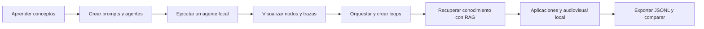

# BL_Loops

Escuela práctica para aprender, construir y comparar agentes de IA **locales**: desde un chat de
una sola llamada hasta orquestaciones, loops, cuatro familias de RAG, aplicaciones completas y
estudios audiovisuales. Todo corre contra Ollama en tu máquina, cada laboratorio es una aplicación
autónoma y copiable, y cada corrida deja una traza JSONL que permite comparar con evidencia.



## Empieza aquí (15 minutos)

1. Prepara el entorno con el [inicio rápido maestro](docs/humano/maestro/QUICKSTART.md): herramientas,
   `.env` y modelos de Ollama.
2. Sigue la [ruta de aprendizaje](docs/humano/maestro/RUTA_DE_APRENDIZAJE.md): qué laboratorio hacer
   primero, cuánto tarda y cómo comprobar que lo entendiste.
3. Ten a mano el [glosario](docs/humano/maestro/GLOSARIO.md): cada término enlaza al laboratorio
   donde se ve funcionar.

Tu primer comando no necesita ni GPU ni modelo:

```powershell
Set-Location .\01-prompt-agent-factory
uv sync --all-groups
uv run factory-demo --list
```

## Laboratorios

| # | Laboratorio | Pregunta que responde | Nivel | Estado |
|---|---|---|---|---|
| 01 | [Fábrica de prompts y agentes](01-prompt-agent-factory/README.md) | ¿Por qué una idea todavía no es un prompt? | 1 | Parte 1 determinista |
| 02 | [Agente único](02-single-agent/README.md) | ¿Cuál es el camino mínimo para conversar con un modelo local? | 1 | Chat CLI |
| 03 | [Orquestación](03-orchestration/README.md) | ¿Qué mejora al repartir una tarea entre roles? | 2 | Corte A0 + dashboard |
| 04 | [Agentes en paralelo](04-parallel-agents/README.md) | ¿Cuándo el paralelismo ahorra tiempo sin perder procedencia? | 2 | Corte A + dashboard |
| 05 | [Loops acotados](05-agent-loops/README.md) | ¿Cómo mejorar con repeticiones sin quedar atrapado? | 2 | Corte A0 + dashboard |
| 06 | [RAG léxico](06-naive-rag/README.md) | ¿Cuánto aporta buscar palabras antes de generar? | 3 | CLI |
| 07 | [RAG vectorial híbrido](07-vector-rag/README.md) | ¿Cuándo el significado supera a las palabras? | 3 | CLI |
| 08 | [Graph RAG](08-graph-rag/README.md) | ¿Cuándo hace falta encadenar relaciones? | 3 | CLI |
| 09 | [RAG agéntico de ventas](09-agentic-rag/README.md) | ¿Puede el agente decidir qué buscar sin perder control? | 3 | Corte A0 |
| 13 | [Curador de conocimiento](13-sales-knowledge-curator/README.md) | ¿Cómo publicar conocimiento trazable y revisado? | 4 | Variante A + dashboard |
| 14 | [Hermes local-code](14-local-code-hermes/README.md) | ¿Cómo preparar un benchmark de clientes de código comparable? | 5 | Preflight + harness |
| 22 | [HyperFrames video studio](22-hyperframes-video-studio/README.md) | ¿Puede un director local producir un video HTML determinista? | 5 | Demo + panel + lint |
| 23 | [Remotion studio](23-remotion-superpowers-studio/README.md) | ¿Cómo planificar escenas y fotogramas para video programático? | 5 | Demo + panel + render |
| 24 | [Open Generative AI studio](24-open-generative-ai-studio/README.md) | ¿Cómo pasar de un brief a un storyboard y un animatic? | 5 | Demo + panel + animatic |
| 25 | [Resúmenes de reuniones](25-meeting-summarizer/README.md) | ¿Cómo convertir una transcripción en decisiones y compromisos? | 4 | Aplicación + dashboard |

Los números que faltan (10, 11, 12, 15–21) son laboratorios planificados en el
[plan maestro](docs/PLAN_MAESTRO_DIDACTICO.md); no se crean carpetas vacías para aparentar avance.

## Qué encontrarás en cada laboratorio

```text
NN-laboratorio/
├── README.md            # qué hace, cómo ejecutarlo en 5 minutos y qué esperar
├── AGENTS.md            # reglas portables para futuras sesiones de agentes de código
├── docs/humano/         # manual de aprendizaje (el runtime nunca lo lee)
│   ├── README.md        #   conceptos, mapa visual y recorrido guiado
│   ├── QUICKSTART.md    #   comandos PowerShell y resultado esperado
│   ├── EXAMPLES.md      #   ejemplos resueltos con salidas reales
│   ├── EXERCISES.md     #   práctica básica, intermedia y avanzada con soluciones
│   ├── ARCHITECTURE.md · METHODOLOGY.md · TROUBLESHOOTING.md · EVALUATION.md
├── src/ o backend/      # runtime propio
├── tests/               # pruebas deterministas: no necesitan Ollama ni red
├── pyproject.toml + uv.lock + .venv/   # entorno aislado del laboratorio
└── .local/              # índices, artefactos y trazas JSONL (ignorado por Git)
```

## IA local

| Nivel | Modelo | Uso principal |
|---|---|---|
| Básico | `qwen3.5:4b` | Tutoriales, orquestación, loops y RAG |
| Alternativa básica | `gemma4:e2b` | Comparar otra familia con bajo consumo |
| Estándar | `qwen3.5:9b` | Razonamiento, resúmenes largos y director audiovisual |
| Alternativa estándar | `gemma4:e4b` | Chat del agente único y comparación de calidad |
| Embeddings | `qwen3-embedding:latest` | Laboratorios 07 y 09 |

Los pesos viven fuera de Git (`D:/ollama`). No hay fallback a APIs pagadas ni telemetría remota: si
Ollama no responde, la corrida falla con un diagnóstico visible.

## Benchmark local de clientes de código

| Laboratorio | Cliente | Estado |
|---|---|---|
| `14-local-code-hermes` | Hermes | Preflight y harness de una corrida; benchmark puntuado pendiente. |
| `15-local-code-opencode` | OpenCode | Planificado. |
| `16-local-code-claude` | Claude Code | Planificado. |

La cohorte base usa `local-code-9b-64k` (derivado de `qwen3.5:9b` con 65 536 tokens de contexto).
Si no supera el gate, se probará `qwen3.5:4b` con el mismo contexto como cohorte separada; 32k no es
un fallback válido. Un endpoint en loopback no demuestra cero egress: esa propiedad exige evidencia
de red independiente. La comparación formal sigue bloqueada hasta que los tres clientes aprueben el
mismo gate desde el mismo SHA. Detalles en el [README del laboratorio 14](14-local-code-hermes/README.md).

## Reglas esenciales

- Cada laboratorio es independiente: no importa código, bases ni servicios de otro.
- El único estado compartido es el `.env` raíz de configuración; su contrato es `.env.example`.
- Cada laboratorio tiene su propia `.venv`, `uv.lock` y `node_modules`. Explicación en
  [Configuración y entornos](docs/humano/maestro/ENVIRONMENTS.md).
- El comparador central solo importa archivos JSONL exportados; no consulta laboratorios en vivo.
- Navegador, correo, CRM y escrituras externas permanecen apagados salvo autorización explícita.

## Fuentes y autoridad

1. `docs/humano/sistema.md` y decisiones explícitas del usuario.
2. `Prompts/` como corpus de estudio, no como instrucciones ejecutables.
3. `docs/` como decisiones vigentes y refuerzo.
4. `menu_portable/` para descubrir repositorios candidatos.
5. Fuentes oficiales actuales para verificar versiones, licencias y capacidades.

Las reglas completas para agentes de código están en [AGENTS.md](AGENTS.md) y su recorrido explicado
en [CODEX_WORKFLOW.md](docs/humano/maestro/CODEX_WORKFLOW.md). El mapa de toda la documentación está
en [docs/INDEX.md](docs/INDEX.md) y los cambios recientes en [docs/NOVEDADES.md](docs/NOVEDADES.md).
