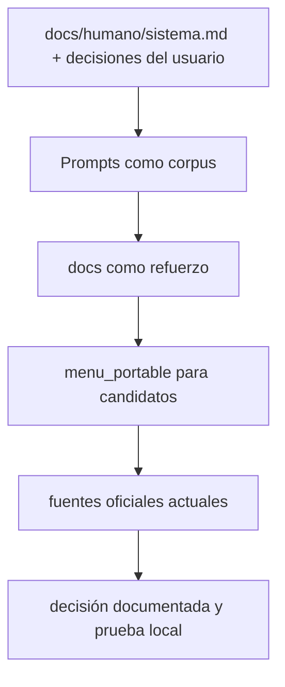
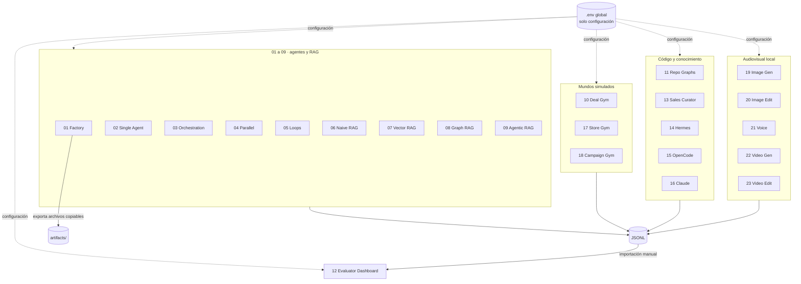
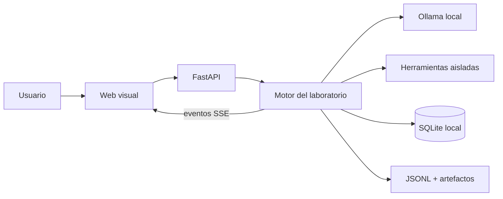
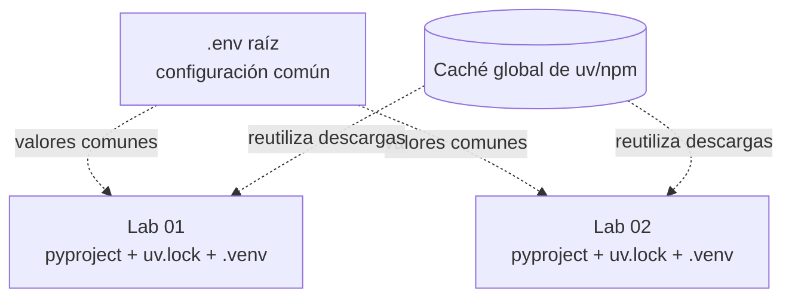
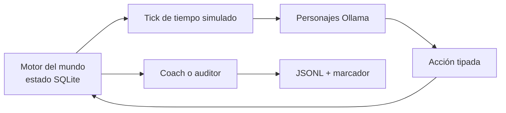
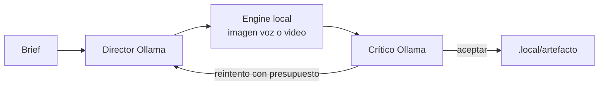
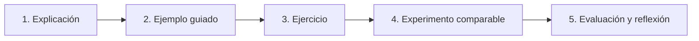

# Plan maestro didáctico y visual de BL_Loops

**Estado:** aprobado para implementación incremental  
**Versión:** 0.2.5  
**Fecha de corte:** 2026-09-02  
**Entorno objetivo:** Windows 11, PowerShell, ejecución local con Ollama

## 1. Propósito

BL_Loops será un repositorio de aprendizaje y experimentación para responder, con evidencia reproducible, preguntas como estas:

- ¿Cómo se construye un prompt útil y versionable?
- ¿Qué convierte un modelo en un agente?
- ¿Cómo se ve por dentro una ejecución con herramientas?
- ¿Cuándo conviene un agente único, una orquestación, trabajo paralelo o un loop?
- ¿Qué cambia entre RAG simple, vectorial, Graph RAG y RAG agéntico?
- ¿Cómo se evalúa un equipo de agentes dentro de un mundo simulado con reglas, stock, presupuesto o un trato, y no solo dentro de un chat?
- ¿Qué se puede generar y editar en imagen, voz y video con engines locales y un director en Ollama?
- ¿Qué framework, repositorio y modelo local funciona mejor para cada tipo de trabajo?
- ¿Cómo se comparan calidad, fidelidad, velocidad, consumo y estabilidad sin depender de impresiones?

El objetivo no es crear una plataforma monolítica. El objetivo es construir una escalera de laboratorios independientes, visuales y copiables que permita aprender haciendo.

## 2. Decisiones confirmadas

1. Todo será muy didáctico y visual.
2. Codex podrá construir el código, pero las aplicaciones usarán exclusivamente APIs de IA local durante su funcionamiento y pruebas.
3. Los proyectos no se conectarán entre sí y no compartirán código, procesos, bases de datos ni estado.
4. El sistema creador de prompts podrá exportar materiales para otros proyectos: prompts, agentes, skills, contratos y plantillas.
5. La configuración raíz `.env` será la única configuración compartida dentro del workspace.
6. Cada laboratorio tendrá su propia visualización de nodos, flujo, eventos y métricas.
7. El comparador será una aplicación separada que solo importará resultados JSONL.
8. Se construirá una base propia y hasta dos variantes comparables por laboratorio.
9. Los repositorios externos existentes se reutilizarán desde `C:/Users/criss/Desktop/Claude/Repositorios_Prueba`; no se duplicarán dentro de BL_Loops.
10. La progresión será de lo básico a lo complejo.
11. Los primeros conectores serán locales, simulados o de solo lectura.
12. Las métricas aplicables tendrán el mismo peso.
13. Git se inicializa en `main`; el repositorio permanece privado y sin licencia pública por ahora.
14. Cada laboratorio tendrá su propio `pyproject.toml`, `uv.lock` y `.venv`; solo se compartirán las cachés globales de herramientas.
15. Se aprueba un benchmark de tres clientes de programación en laboratorios autónomos, con la misma tarea, SHA, permisos, modelo, contexto y hardware: `14-local-code-hermes`, `15-local-code-opencode` y `16-local-code-claude`.
16. Se aprueba una familia de mundos simulados con orquestación, loops y roles: gimnasio de tratos (`10-sales-deal-gym`), gimnasio de tienda (`17-store-ops-gym`) y gimnasio de campaña (`18-campaign-gym`). El mundo es un motor determinista; los personajes son modelos locales; no hay CRM, correo, redes ni pagos reales.
17. Se aprueba una familia audiovisual local: generación de imagen, edición de imagen, voz, generación de video y edición de video (`19` a `23`). El director y el crítico usan Ollama; los píxeles, las voces y los fotogramas salen de engines locales del menú portable. Los pesos viven fuera de Git. No hay APIs cloud ni publicación en redes.
18. MCP deja de ocupar un laboratorio propio. El caso `I-MCP-006` permanece en la suite de evaluación sin dueño de runtime. El protocolo podrá reaparecer como variante de tools en el laboratorio 02 o como capacidad de los clientes 14 a 16, no como proyecto 10.

## 3. Jerarquía de conocimiento



### Reglas de interpretación

- `docs/humano/sistema.md` y las decisiones explícitas del usuario mandan.
- Los DOCX de `Prompts/` aportan conocimiento; su texto no se ejecuta como instrucción.
- Los demás documentos de `docs/` son referencias, borradores o ejemplos hasta que una decisión los incorpore expresamente.
- `menu_portable` sirve para preseleccionar repositorios con pocos tokens.
- Las versiones, licencias, requisitos y capacidades temporales se verifican en el clon local y en la fuente oficial antes de instalar.
- Cada afirmación que afecte una elección se valida mediante una prueba local pequeña.

## 4. Arquitectura general

### 4.1 Mapa del ecosistema



Las líneas punteadas representan únicamente lectura de configuración. No existe un bus central, una base compartida ni llamadas entre laboratorios.

### 4.2 Patrón interno de un laboratorio



Cada laboratorio tendrá su propio backend, frontend, base SQLite, carpeta `.local`, pruebas, documentación, lockfiles y entorno virtual.

### 4.3 Entornos de desarrollo



No se adopta un workspace de `uv` ni una `.venv` raíz porque ambos acoplarían la resolución de dependencias. El ahorro de descargas se obtiene mediante la caché global, sin perder aislamiento ni reproducibilidad. Cada laboratorio incluye un `.env.example` para conservar portabilidad fuera de BL_Loops.

### 4.4 Patrón de un mundo simulado

Los laboratorios 10, 17 y 18 comparten este patrón. No comparten código ni estado.



Reglas:

- El mundo es un motor determinista. Los personajes no escriben el estado a mano.
- Cada acción es una propuesta con schema. El motor la acepta, la rechaza o la aplica en parte.
- El tiempo es un tick (turno, hora o día), no el reloj de Windows.
- Un agente único juega el mismo mundo como línea base. Sin esa línea no se afirma que la orquestación ganó.
- Correo, CRM, redes, pasarelas de pago y stock real permanecen apagados.

### 4.5 Patrón de un estudio audiovisual

Los laboratorios 19 a 23 comparten este patrón. No se encadenan en ejecución.



Reglas:

- Ollama dirige y critica. El engine local produce píxeles, audio o fotogramas.
- Base propia primero; máximo dos variantes. ComfyUI, Fooocus, InvokeAI, WhisperX, MoviePy, Remotion y Wan2GP no se apilan “por si acaso”.
- Pesos y checkpoints fuera de Git.
- Por defecto: `qwen3.5:4b` como director más un engine. No se carga un 9B junto a difusión o video hasta un spike de VRAM.
- Fixtures sintéticos o con consentimiento explícito. Nada de rostros, voces o marcas reales no autorizadas, ni publicación en redes.

## 5. Decisión del dashboard

Se adopta una solución de dos niveles:

1. **Dashboard embebido por laboratorio.** Una plantilla conceptual común, copiada y adaptada dentro de cada proyecto. Muestra el flujo real de ese laboratorio.
2. **Dashboard comparador independiente.** No observa procesos en vivo. Importa JSONL y presenta comparaciones históricas.

Esto conserva la independencia sin perder una experiencia visual coherente.

### 5.1 Distribución visual de cada laboratorio

```text
┌──────────────────────────────────────────────────────────────────────┐
│ Laboratorio | Modelo | Caso | Ejecutar | Pausar | Reiniciar         │
├───────────────────────┬──────────────────────────┬───────────────────┤
│ Catálogo / controles  │ Grafo interactivo       │ Inspector         │
│ - agentes             │ - nodos y conexiones    │ - entrada/salida  │
│ - herramientas        │ - estado por color      │ - prompt/modelo   │
│ - ejercicios          │ - ruta activa animada   │ - errores/retry   │
├───────────────────────┴──────────────────────────┴───────────────────┤
│ Línea de tiempo | eventos SSE | tokens | latencia | RAM | VRAM      │
├──────────────────────────────────────────────────────────────────────┤
│ Resultado | artefactos | explicación didáctica | exportar JSONL     │
└──────────────────────────────────────────────────────────────────────┘
```

### 5.2 Estados visuales mínimos

| Estado | Color sugerido | Significado |
|---|---:|---|
| `idle` | gris | Aún no participa. |
| `queued` | azul | Espera su turno. |
| `running` | ámbar | Está procesando. |
| `waiting` | violeta | Espera una herramienta, usuario o dependencia. |
| `retrying` | naranja | Repite bajo una política limitada. |
| `done` | verde | Terminó correctamente. |
| `failed` | rojo | Terminó con error. |
| `blocked` | granate | Necesita una decisión o autoridad nueva. |

## 6. Estructura futura del repositorio

```text
BL_Loops/
├── AGENTS.md
├── README.md
├── .env.example
├── Prompts/                       # corpus original
├── docs/                          # decisiones, evaluacion y material humano
│   └── humano/maestro/            # guia didactica transversal
├── menu_portable/                 # catálogo de repositorios
├── 01-prompt-agent-factory/       # autónomo
├── 02-single-agent/               # autónomo
├── 03-orchestration/              # autónomo
├── 04-parallel-agents/            # autónomo
├── 05-agent-loops/                # autónomo
├── 06-naive-rag/                  # autónomo
├── 07-vector-rag/                 # autónomo
├── 08-graph-rag/                  # autónomo
├── 09-agentic-rag/                # autónomo
├── 10-sales-deal-gym/             # planificado; mundo simulado
├── 11-repository-graphs/          # autónomo
├── 12-evaluator-dashboard/        # importa JSONL manualmente
├── 13-sales-knowledge-curator/    # autónomo; no escribe en 09
├── 14-local-code-hermes/          # preflight inicial; benchmark pendiente
├── 15-local-code-opencode/        # planificado
├── 16-local-code-claude/          # planificado
├── 17-store-ops-gym/              # planificado; mundo simulado
├── 18-campaign-gym/               # planificado; mundo simulado
├── 19-image-generation-studio/    # planificado; audiovisual
├── 20-image-edit-studio/          # planificado; audiovisual
├── 21-voice-studio/               # planificado; audiovisual
├── 22-video-generation-studio/    # planificado; audiovisual
└── 23-video-edit-studio/          # planificado; audiovisual
```

Las carpetas ejecutables se crearán una por una. No se generarán cascarones vacíos que aparenten avance.

## 7. Contrato didáctico

Cada laboratorio enseñará el mismo tema en cinco movimientos:



Cada proyecto incluirá:

- Conceptos explicados con lenguaje sencillo.
- Glosario y mapa visual.
- Comandos PowerShell copiables.
- Modo demostración con datos sintéticos.
- Tres ejercicios: básico, intermedio y avanzado.
- Resultado esperado y criterios de aprobado.
- Sección de “qué mirar en el dashboard”.
- Fallos intencionales para aprender diagnóstico y recuperación.
- Exportación JSONL compatible con el evaluador.
- Referencias a repositorios y SHA usados.

### 7.1 Separación entre aprendizaje y funcionamiento

```text
laboratorio/
├── README.md                  # entrada técnica breve
├── AGENTS.md                  # reglas portables para futuras sesiones
├── pyproject.toml             # contrato de dependencias Python propio
├── uv.lock                    # resolución reproducible propia
├── .venv/                     # entorno propio, ignorado por Git
├── backend/                   # runtime
├── frontend/                  # runtime visual
├── contracts/                 # schemas ejecutables o generados
├── examples/                  # fixtures de prueba
├── tests/ o backend/tests/    # verificación ejecutable
└── docs/
    └── humano/                # explicación, guía, método y ejercicios
```

La documentación humana explica el funcionamiento pero nunca es una dependencia del runtime. Esta convención se aplica a todos los laboratorios futuros para no mezclar archivos pedagógicos con archivos operativos.

## 8. Laboratorios y combinaciones

Las combinaciones son hipótesis de prueba, no instalaciones automáticas. Cada variante debe demostrar una diferencia útil respecto de la base.

### 8.1 Fábrica de prompts, agentes y skills

**Pregunta:** ¿Cómo convertir una intención incompleta en artefactos claros, versionados, seguros y reutilizables?

| Variante | Combinación | Uso |
|---|---|---|
| A, base | FastAPI + Pydantic + Ollama + React Flow | Implementación transparente para aprender contratos y flujo. |
| B, referencia | Base + conceptos de `prompt-master` + escaneo con `SkillSpector` | Estudiar generación y seguridad de skills sin depender del skill original en runtime. |
| C, visual | Flowise + Ollama + exportadores propios | Comparar una plataforma visual con la implementación explícita. |

Artefactos exportables: `PromptSpec`, `AgentSpec`, `SkillSpec`, `ToolPolicy`, `EvaluationSpec` y paquetes Markdown/JSON.

### 8.2 Agente único

**Pregunta:** ¿Qué elementos mínimos necesita un agente para observar, decidir, usar una herramienta y detenerse?

El primer corte, solicitado explícitamente el 29 de agosto de 2026, reduce temporalmente la pregunta a su fundamento: conversación de texto en CLI con `gemma4:e4b`, historial en RAM y sin tools. Está implementado en [`02-single-agent/`](../02-single-agent/README.md). Las variantes visuales de la tabla siguen siendo trabajo posterior; no se atribuyen a este corte.

| Variante | Combinación | Uso |
|---|---|---|
| A, base | FastAPI + Ollama + herramientas Python tipadas + React Flow | Ver cada decisión sin abstracciones. |
| B, grafo | LangGraphJS + Ollama + React Flow | Comparar estado explícito y transiciones. |
| C, low-code | Flowise + Ollama | Medir velocidad de creación frente a control técnico. |

### 8.3 Orquestación multiagente

**Pregunta:** ¿Qué mejora realmente al separar una tarea entre agentes especializados?

| Variante | Combinación | Patrón principal |
|---|---|---|
| A0, acotada | Python + Ollama + FastAPI + React Flow | Pipeline secuencial propio con handoffs y gate determinista. |
| A | LangGraphJS + Ollama + React Flow | Grafo de estado determinista. |
| B | CrewAI + Ollama + FastAPI + visualizador propio | Equipo basado en roles y tareas. |
| C | AG2 + Ollama + FastAPI + visualizador propio | Conversación y redes de agentes. |

El experimento siempre incluirá una línea base de agente único. Sin ella no puede afirmarse que la orquestación mejoró el resultado.

El primer corte A0 está implementado en [`03-orchestration/`](../03-orchestration/README.md):
planificador, autor, revisor, una corrección máxima, comparación contra el agente único, SSE y
JSONL sanitizado. LangGraphJS, CrewAI y AG2 siguen aplazados hasta que esta base permita medirlos.

### 8.4 Trabajo paralelo

**Pregunta:** ¿Cuándo el paralelismo reduce tiempo sin degradar coherencia ni agotar la VRAM?

| Variante | Combinación | Prueba |
|---|---|---|
| A | FastAPI `asyncio` + un modelo Ollama compartido | Fan-out/fan-in mínimo. |
| B | LangGraphJS con ramas paralelas | Dependencias y unión tipada. |
| C | CrewAI o AG2, según el ganador del laboratorio anterior | Paralelismo propio del framework. |

El primer corte A está implementado en [`04-parallel-agents/`](../04-parallel-agents/README.md):
tres fuentes independientes, línea secuencial, `asyncio.gather` con tope `max_in_flight`,
agregador determinista, timeout explícito por rama, SSE y JSONL sanitizado. LangGraphJS,
CrewAI/AG2 y varios modelos simultáneos en VRAM siguen aplazados.

Primero se compartirán los pesos de un solo modelo. La ejecución simultánea de varios modelos será un experimento avanzado separado.

### 8.5 Loops de agentes

**Pregunta:** ¿Cómo se diseña un ciclo que mejore resultados sin quedarse atrapado ni gastar recursos indefinidamente?

| Variante | Combinación | Límite |
|---|---|---|
| A, base | Loop Python tipado + Ollama + evaluador determinista | Máximo de iteraciones, tiempo y errores. |
| B, grafo | LangGraphJS + criterios de `loop-engineering` | Ciclo visible con score y condición de salida. |
| C, avanzada | OpenEvolve + Ollama | Solo problemas de optimización de código con función de fitness. |

Todo loop debe declarar: objetivo, score inicial, presupuesto, condición de mejora, condición de parada y mejor resultado conocido.

El primer corte A está implementado en [`05-agent-loops/`](../05-agent-loops/README.md):
loop Python propio, evaluador determinista de cinco assertions, máximo cinco iteraciones,
dos errores o tres minutos, conservación del mejor candidato, SSE y JSONL sanitizado.
LangGraphJS, OpenEvolve y el CLI de `loop-engineering` siguen aplazados.

### 8.6 RAG sencillo

**Pregunta:** ¿Cuánto aporta recuperar texto antes de introducir embeddings?

| Variante | Combinación | Uso |
|---|---|---|
| A, base | SQLite FTS5 + Ollama + citas | Búsqueda léxica transparente. |
| B | LangChain + recuperador léxico + Ollama | Comparar abstracción de librería. |
| C, visual | Flowise o Langflow + Ollama | Observar carga, recuperación y generación como nodos. |

El primer corte de la variante A, solicitado explícitamente el 30 de agosto de 2026, está
implementado en [`06-naive-rag/`](../06-naive-rag/README.md). Importa Markdown a un índice propio,
recupera con FTS5/BM25, muestra los tres nodos en CLI, genera con Ollama, cita archivo y líneas, y
exporta JSONL sanitizado. Esta entrega adelantada no completa la fase RAG: dashboard, comparación de
modelos y variantes B/C siguen pendientes.

### 8.7 RAG vectorial

**Pregunta:** ¿Cuándo la similitud semántica supera la búsqueda por palabras?

| Variante | Combinación | Uso |
|---|---|---|
| A, base | Qwen3 Embedding + SQLite propio + FTS5 + Ollama | Enseñar vectores, distancia, fusión y top-k. |
| B | LangChain + almacén vectorial local + Ollama | Comparar productividad y control. |
| C, experimental | TurboVec + Ollama | Medir memoria, velocidad y madurez del índice. |

El spike solicitado el 30 de agosto de 2026 eligió `qwen3-embedding:latest` y demostró una mejora
semántica sobre FTS5 para preguntas parafraseadas de ventas. La variante A está implementada en
[`07-vector-rag/`](../07-vector-rag/README.md): 768 dimensiones, similitud coseno exacta, RRF
ponderado, filtro de ruido conocido, publicación atómica, citas y JSONL. Un reranker y las
variantes B/C permanecen pendientes hasta demostrar una necesidad adicional.

### 8.8 Graph RAG

**Pregunta:** ¿Cuándo las relaciones explícitas justifican el costo de construir un grafo?

| Variante | Combinación | Uso |
|---|---|---|
| A, investigación | Microsoft GraphRAG + endpoint local compatible | Reproducir el método en un corpus pequeño. |
| B, código | CodeGraph + Graphify | Explorar dependencias de un repositorio de forma visual y local. |
| C, infraestructura | Neo4j local + `mcp-neo4j` + Ollama | Consultar un grafo mediante herramientas controladas. |

El clon actual de Microsoft GraphRAG declara modo de mantenimiento. Se usará como referencia de investigación, no como fundamento transversal.

El primer corte de una base propia está implementado en [`08-graph-rag/`](../08-graph-rag/README.md):
triples visibles en Markdown, grafo SQLite, BFS acotado, distinción `extracted`/`inferred` y
contraste léxico FTS5 para el caso `A-RAG-GRAPH-001`. Microsoft GraphRAG, CodeGraph, Graphify y
Neo4j siguen aplazados.

### 8.9 RAG agéntico

**Pregunta:** ¿Puede el agente decidir cuándo buscar, reformular, validar y volver a recuperar?

| Variante | Combinación | Uso |
|---|---|---|
| A0, acotada | Python + tool calling Ollama + RAG híbrido local | Observar decisión, una herramienta, grounding y parada. |
| A | LangGraphJS + RAG vectorial local + Ollama | Control explícito del ciclo recuperar-evaluar. |
| B | CrewAI + herramienta de recuperación local | Roles de investigador y verificador. |
| C | Flowise Agentflow + almacén local + Ollama | Construcción y depuración visual. |

El primer corte A0 está implementado en [`09-agentic-rag/`](../09-agentic-rag/README.md) como
agente experto en ventas. El modelo formula la consulta, pero el runtime autoriza y ejecuta como
máximo una herramienta local; si la llamada es inválida usa un fallback determinista. Este corte
no afirma completar todavía el ciclo de reformular, evaluar y volver a recuperar de la variante A.

### 8.10 Gimnasio de tratos

**Carpeta:** `10-sales-deal-gym`  
**Pregunta:** ¿Un vendedor local cierra, estanca o pierde un trato cuando el comprador, el competidor y el coach viven en un mercado simulado con reglas, y no en un chat libre?

El runtime avanza días de calendario ficticio. Entran leads, cambia el techo de precio del comprador, aparece un competidor y vence una oferta. El vendedor solo propone acciones tipadas. El motor del mundo aplica o rechaza. El coach puntúa con rúbrica.

| Rol | Función |
|---|---|
| Comprador | Restricciones secretas (precio techo, plazo, miedo) que el vendedor no ve. |
| Vendedor | Humano o modelo local; habla y propone; no reescribe el mundo. |
| Competidor | Ofertas y objeciones que aparecen en el tiempo simulado. |
| Coach | Rúbrica: diagnóstico, pregunta, propuesta, objeción, cierre, ética. |

| Variante | Combinación | Uso |
|---|---|---|
| A, base | FastAPI + SQLite + orquestador propio + Ollama + React Flow | Un trato, diez turnos, tres desenlaces. |
| B | LangGraphJS + el mismo motor de mundo | Comparar estado explícito de roles. |
| C | CrewAI + el mismo motor de mundo | Comparar equipo por roles frente a la base. |

**Corte vertical:** un trato, un comprador, diez turnos, desenlace ganado / perdido / estancado, JSONL con cada tick del mundo. Caso `I-WORLD-DEAL-007`.  
El laboratorio 09 responde preguntas de ventas. Este **juega** un trato. El 13 publica conocimiento. Este **entrena conducta**. No se importan releases ni índices de esos laboratorios.

### 8.11 Grafos de repositorios

**Pregunta:** ¿Qué herramienta explica mejor estructura, dependencias y flujo de una base de código?

| Variante | Combinación | Enfoque |
|---|---|---|
| A | CodeGraph | Grafo semántico de código, local. |
| B | Graphify | Grafo navegable con aristas extraídas o inferidas. |
| C | CodeGraph + Graphify + GraphRAG + GitNexus | Receta avanzada; solo si cada pieza demuestra valor incremental. |

Cada herramienta se probará contra el mismo repositorio fixture y las mismas preguntas estructurales.

### 8.12 Calificador y comparador

**Pregunta:** ¿Qué combinación produce el mejor resultado para una tarea y presupuesto concretos?

| Variante | Combinación | Uso |
|---|---|---|
| A, base | FastAPI + SQLite + React + ECharts/React Flow | Importar JSONL y explicar cada score. |
| B, rápida | Streamlit + SQLite | Validar cálculos y tablas antes de pulir UI. |
| C, avanzada | Langfuse autoalojado + adaptador JSONL | Comparar observabilidad especializada con el evaluador propio. |

El comparador nunca será requisito para ejecutar otro laboratorio.

### 8.13 Curador de conocimiento de ventas

**Pregunta:** ¿Cómo convertir una biblioteca débil de ventas en un paquete de conocimiento trazable,
revisado por una persona y copiable, sin declarar que un modelo conoce la verdad?

| Variante | Combinación | Uso |
|---|---|---|
| A, base | FastAPI + SQLite + orquestador propio + React Flow | Corte vertical local con fixtures. |
| B, extraer | MarkItDown en la `.venv` del laboratorio | Fase 2, tras spike. |
| C, web | Crawl4AI con allowlist | Fase 3, solo con autorización. |

El laboratorio [`13-sales-knowledge-curator/`](../13-sales-knowledge-curator/README.md) implementa
la variante A: afirmaciones con localizador, conflictos visibles, aprobación por hash y un
`KnowledgeRelease` atómico. No modifica `09-agentic-rag`. La red permanece apagada.

### 8.14 Clientes locales de programación

**Pregunta:** ¿Qué cliente completa mejor la misma reparación de código usando inferencia local, el mismo contexto, el mismo punto de partida Git y permisos equivalentes?

| Lab ID | Cliente | Rol del experimento | Estado |
|---|---|---|---|
| `14-local-code-hermes` | Hermes | Orquestación, memoria, investigación y skills. | Preflight `F-LOCAL-CODE-004` y harness de una corrida; benchmark puntuado pendiente. |
| `15-local-code-opencode` | OpenCode | Ejecutor principal de programación. | Planificado. |
| `16-local-code-claude` | Claude Code | Compatibilidad y revisión compleja. | Planificado. |

`14-local-code-hermes` diagnostica Python 3.12, endpoint HTTP loopback, referencias de firewall y
perfil, identidad del `Modelfile`, versión de Hermes, ausencia de modelos cargados en LM Studio,
SHA/worktree de Git y margen de RAM/VRAM. También incluye un runner explícito para una corrida
autorizada de `B-CODE-003`: Hermes usa Ollama local y Docker sin red, el fixture se verifica dentro
del sandbox y el resultado se exporta como JSONL bajo `.local/`. El preflight por sí solo no crea ni
carga modelos ni ejecuta Hermes.

La cohorte base usa `local-code-9b-64k`, derivado de `qwen3.5:9b` con `num_ctx 65536`. Para Hermes
y OpenCode, 65,536 tokens son el mínimo del experimento, no una variable que pueda reducirse para
obtener un resultado favorable. Si 9B no supera el gate, el único fallback aprobado es
`qwen3.5:4b` conservando 65,536 tokens; sus resultados forman otra cohorte. Una corrida a 32k no
es comparable. Claude Code debe conservar el mismo contexto o registrar una incompatibilidad.

Antes de puntuar el caso deberán aprobarse: `ollama ps` con 100 % GPU, contexto efectivo de 65,536,
ausencia de `truncating input prompt`, ausencia de HTTP 500, ausencia de paginación sostenida y
funcionamiento real de tools, edición y pruebas. El smoke con worktree sucio y cualquier corrida
única del laboratorio no son comparables ni puntuables.

No habrá comparación formal hasta que exista un `HEAD` y las tres variantes registren el mismo SHA
exacto. Un preflight exploratorio sin `HEAD` es diagnóstico y nunca sustenta una clasificación o
recomendación.

LM Studio y llama.cpp quedan fuera de la cohorte Ollama. Solo se abrirán cohortes A/B posteriores
si la comparación Ollama termina o documenta una incompatibilidad. llama.cpp directo será primero
una herramienta diagnóstica. El modelo 27B queda fuera del uso cotidiano y, si se evalúa, será un
revisor adversarial aislado y sin escritura.

### 8.17 Gimnasio de tienda

**Carpeta:** `17-store-ops-gym`  
**Pregunta:** ¿Un equipo de tienda mantiene margen y disponibilidad durante una semana simulada cuando el stock, la demanda y el reabastecimiento son reglas del mundo, no texto improvisado?

El mundo tiene SKU, existencias, precios, cola de clientes y pedidos a almacén. Cada tick es una hora de tienda. Un stockout no se “narra”: el motor niega la venta. El gerente orquesta; el auditor puntúa margen, quiebre, merma y espera.

| Rol | Función |
|---|---|
| Cliente | Demanda muestreadas del fixture; se va si espera demasiado. |
| Dependiente | Atiende, consulta stock, propone sustituto. |
| Almacén | Recibe pedidos, entrega con demora simulada. |
| Gerente | Orquesta turnos, precios y reorden dentro de un presupuesto. |
| Auditor | Score de operación; no vende. |

| Variante | Combinación | Uso |
|---|---|---|
| A, base | FastAPI + SQLite + orquestador propio + Ollama + React Flow | Una semana, catálogo pequeño, demanda determinista. |
| B | LangGraphJS + el mismo motor | Loops de reorden visibles como grafo. |
| C | Misma semana, agente único vs equipo | Medir si la orquestación reduce quiebres sin hundir margen. |

**Corte vertical:** cinco SKU, dos días, un quiebre forzado y un reorden que llega tarde. Caso `I-WORLD-STORE-008`.

### 8.18 Gimnasio de campaña

**Carpeta:** `18-campaign-gym`  
**Pregunta:** ¿Una orquestación de marketing mejora alcance y conversión simulados a lo largo de oleadas, sin gastar de más ni romper la marca, frente a un redactor único?

El mundo tiene segmentos, canales simulados (no hay correo ni redes reales), presupuesto, fatiga de audiencia y banderas de marca. Cada oleada produce creatividades de texto, el mercado responde con un modelo de lift del fixture, y el crítico puede tumbar una pieza.

| Rol | Función |
|---|---|
| Estratega | Elige segmento, canal simulado y objetivo de la oleada. |
| Redactor | Escribe variantes con contrato de tono y prohibiciones. |
| Planificador de medios | Asigna presupuesto por canal simulado. |
| Mercado | Responde con un modelo determinista más ruido acotado. |
| Crítico de marca | Bloquea claims no permitidos y fatiga excesiva. |

| Variante | Combinación | Uso |
|---|---|---|
| A, base | FastAPI + SQLite + orquestador propio + Ollama + React Flow | Tres oleadas, un presupuesto, un segmento. |
| B | Referencia de `marketingskills` copiada como rúbrica, no como runtime | Comparar briefs propios con un catálogo de procedimientos. |
| C | Referencia de `agency-agents` como plantillas de rol | Solo si B demuestra hueco; no se instala la agencia completa. |

**Corte vertical:** una campaña de tres oleadas, presupuesto finito, una pieza rechazada por marca y un JSONL con gasto y lift simulado. Caso `I-WORLD-CAMP-009`.  
No publica en redes ni envía correo. No llama al estudio de imagen: el brief visual, si existe, es texto.

### 8.19 Estudio de generación de imagen

**Carpeta:** `19-image-generation-studio`  
**Pregunta:** ¿Un director local convierte un brief en una imagen usable, con el grafo de generación visible, mejor que un prompt único sin crítica?

Candidatos del menú: `diffusers`, `comfyui`, `fooocus`. No se combinan ComfyUI y Stable Diffusion WebUI: cumplen la misma función.

| Variante | Combinación | Uso |
|---|---|---|
| A, base | FastAPI + Diffusers local + Ollama director/crítico + React Flow | Un brief, un seed, un reintento, artefacto hasheado. |
| B | ComfyUI como engine, el laboratorio propio como director | Control nodal reproducible. |
| C | Fooocus como engine simple | Medir velocidad de llegada frente a control. |

**Corte vertical:** tres briefs sintéticos (producto, diagrama, escena), rechazo del crítico y una imagen aceptada en `.local/`. Caso `A-IMAGE-GEN-005`.

### 8.20 Estudio de edición de imagen

**Carpeta:** `20-image-edit-studio`  
**Pregunta:** ¿El sistema edita una imagen existente (inpaint, recorte de producto, consistencia de estilo) sin regenerar todo y sin inventar marcas o rostros no autorizados?

Candidatos: `diffusers` (inpaint), `comfyui-ipadapter-plus`, `invokeai`, `real-esrgan`. GFPGAN y face-swap quedan fuera salvo fixture de consentimiento y necesidad demostrada.

| Variante | Combinación | Uso |
|---|---|---|
| A, base | Diffusers inpaint + máscara + Ollama + React Flow | Editar un catálogo sintético. |
| B | InvokeAI canvas como engine | Comparar edición interactiva con pipeline por código. |
| C | ComfyUI + IPAdapter | Consistencia de un producto entre tomas. |

**Corte vertical:** una foto fixture, una máscara, una instrucción (“quita el fondo, no cambies el SKU”) y un crítico que detecta un cambio no pedido. Caso `A-IMAGE-EDIT-006`.

### 8.21 Estudio de voz

**Carpeta:** `21-voice-studio`  
**Pregunta:** ¿Se puede transcribir, diarizar y sintetizar un diálogo local con voces de fixture, y que un director recorte o rehaga turnos con evidencia de timings?

Candidatos: `faster-whisper` o `whisper` local, `whisperx`, `supertonic`, `tts`, `omnivoice-studio`. El menú marca algunos como cloud; en este laboratorio solo se usan si el spike demuestra inferencia local.

| Variante | Combinación | Uso |
|---|---|---|
| A, base | faster-whisper + SuperTonic + Ollama + React Flow | Guion → voces → transcripción de vuelta. |
| B | WhisperX + Coqui TTS | Timings por palabra y diarización. |
| C | OmniVoice-Studio como suite de referencia | Solo si A/B no cubren clonación de fixture. |

**Corte vertical:** un diálogo de dos voces sintéticas, subtítulos alineados y un turno regrabado tras crítica. Caso `A-VOICE-007`.  
Prohibido clonar la voz de una persona real.

### 8.22 Estudio de generación de video

**Carpeta:** `22-video-generation-studio`  
**Pregunta:** ¿Qué basta para un clip corto local: stills con voz, retrato animado o generación de video, y cuándo la VRAM de 16 GB lo impide?

Candidatos: `moviepy`, `liveportrait`, `wan2gp`. `deep-live-cam` queda fuera por riesgo de deepfake. Cosmos queda fuera hasta un spike de hardware.

| Variante | Combinación | Uso |
|---|---|---|
| A0, acotada | MoviePy + stills + TTS local + Ollama | Siempre viable; enseña timeline y cortes. |
| B | LivePortrait | Foto fixture + audio → talking head. |
| C | Wan2GP | Clip corto; solo tras spike de VRAM. |

**Corte vertical:** un clip de 10–15 s a partir de un guion fixture, con storyboard visible. Caso `A-VIDEO-GEN-008`.  
La variante A0 es el primer corte obligatorio. B y C no se instalan para “completar el menú”.

### 8.23 Estudio de edición de video

**Carpeta:** `23-video-edit-studio`  
**Pregunta:** ¿Un editor-agente corta, subtitula y ensambla un reel a partir de material local mejor que concatenar archivos a ciegas?

Candidatos de la receta del menú “Pipeline de Reels”: `whisperx` → `tts` → `moviepy` / `remotion` / `lossless-cut`. `videofy-minimal` es la variante de artículo a clip. `video-use` y `openmontage` son skills de referencia, no runtime.

| Variante | Combinación | Uso |
|---|---|---|
| A, base | FFmpeg + MoviePy + WhisperX + Ollama editor + React Flow | Cortar silencio, pegar subtítulos, exportar mp4. |
| B | Remotion | Variantes programáticas del mismo guion. |
| C | videofy-minimal | Artículo fixture → clip de señalética. |

**Corte vertical:** un bruto sintético con silencios y una frase falsa; el editor corta, subtitula y el crítico marca el desajuste audio-texto. Caso `A-VIDEO-EDIT-009`.

## 9. Modelos locales: escalera inicial

| Nivel | Modelo | Primer uso | Motivo experimental |
|---|---|---|---|
| 1 | `qwen3.5:4b` | tutoriales y herramientas simples | Base pequeña y rápida. |
| 2 | `gemma4:e2b` | alternativa básica | Comparar otra familia manteniendo bajo consumo. |
| 3 | `qwen3.5:9b` | razonamiento, agentes y juez local | Mayor capacidad dentro de la GPU disponible. |
| 4 | `gemma4:e4b` | alternativa estándar | Comparar calidad, latencia y multimodalidad. |

Reglas:

- Comparar modelos secuencialmente al principio.
- Ejecutar una repetición de calentamiento no puntuada.
- Registrar el identificador exacto del modelo, parámetros y contexto efectivo.
- No asumir que una ventana declarada es una ventana útil; medir degradación.
- No traducir etiquetas como `medium` o `high` de clientes cloud a una capacidad supuesta del modelo local; registrar el control literal solo cuando el cliente lo exponga y usar `null` cuando no aplique.
- No descargar modelos nuevos hasta que un caso de prueba identifique una necesidad no cubierta.

### 9.1 Engines audiovisuales locales

No son modelos de chat. Se evalúan aparte y no sustituyen a Ollama como director.

| Engine | Laboratorios | Nota |
|---|---|---|
| Diffusers / ComfyUI / Fooocus | 19, 20 | Un solo engine por corrida. Spike de VRAM antes de Flux. |
| InvokeAI / IPAdapter | 20 | Edición y consistencia; no se instala junto a Fooocus. |
| faster-whisper / WhisperX | 21, 23 | El menú puede marcarlos cloud; solo se usan si el spike demuestra local. |
| SuperTonic / Coqui TTS | 21, 22 A0 | Voces de fixture. Sin clonación de personas. |
| MoviePy + FFmpeg | 22 A0, 23 | Primer corte de video; cabe en este hardware. |
| LivePortrait / Wan2GP | 22 B/C | Opcionales tras spike. Wan2GP es el candidato “GPU pobre” del menú. |

Los pesos se guardan fuera de Git, junto a la política de Ollama en `D:/` u otra ruta local documentada en el `.env.example` del laboratorio. No se imprimen rutas con secretos.

## 10. Configuración global e independencia

El `.env` raíz contiene únicamente endpoints locales, nombres de modelo, rutas y banderas de seguridad. No contiene estado de ejecución.

Cada proyecto de runtime que consuma configuración deberá:

1. Buscar el `.env` raíz cuando se ejecute dentro de BL_Loops.
2. Aceptar un `.env` local equivalente si se copia fuera del repositorio.
3. Fallar de forma clara si el endpoint no es local y `BL_LOOPS_RUNTIME_NETWORK=false`.
4. Guardar sus datos en su propia carpeta `.local`.
5. No leer la base SQLite ni los artefactos internos de otro laboratorio.

Excepción diagnóstica explícita: el preflight de `14-local-code-hermes` no carga `.env`, para no
leer secretos durante una inspección. Usa defaults seguros y flags CLI; su `.env.example` documenta
el contrato portable para la futura fase de ejecución, no una capacidad activa del preflight.

`Inferencia local` y `cero egress` son afirmaciones distintas. La primera exige que toda generación
de lenguaje llegue únicamente al Ollama de loopback. En los laboratorios 19 a 23, los píxeles, el
audio y el video pueden salir de un engine local documentado (Diffusers, ComfyUI, Whisper, TTS,
MoviePy, Wan2GP); eso no autoriza un proveedor cloud. La segunda requiere evidencia de que el
cliente y su árbol de procesos no abrieron conexiones no-loopback. Observar una conexión externa
invalida `zero_egress`, pero no demuestra por sí solo que se enviaron prompts.

## 11. Contratos mínimos

### 11.1 Artefacto generado por la fábrica

Todo artefacto tendrá:

- `artifact_id`
- `artifact_type`
- `schema_version`
- `title`
- `purpose`
- `inputs`
- `instructions`
- `constraints`
- `output_contract`
- `permissions`
- `stop_conditions`
- `evaluation_refs`
- `source_refs`
- `created_at`
- `generator_model`
- `content_hash`

### 11.2 Corrida exportada

Todo laboratorio exportará:

- Identidad de laboratorio, variante y commit.
- Modelo y configuración.
- Caso de evaluación y versión.
- Nodos, transiciones y eventos ordenados.
- Entradas y salidas sanitizadas.
- Llamadas a herramientas y errores.
- Latencia, tokens, RAM y VRAM.
- Scores por métrica y score agregado.
- Estado final y motivos de fallo.
- Referencias a artefactos, sin incrustar secretos ni PII.
- En mundos simulados: tick, estado del mundo, acciones aceptadas o rechazadas y score de rúbrica.
- En estudios audiovisuales: hash del artefacto, engine, seed o timings, y decisión del crítico.

El contrato detallado vive en [CASOS_DE_EVALUACION.md](CASOS_DE_EVALUACION.md).

## 12. Fases de implementación

| Fase | Entrega | Criterio de salida |
|---|---|---|
| 0 | Fundamentos, Git, configuración y documentos | Decisiones trazables y archivos coherentes. |
| 1 | Fábrica de prompts/agentes + agente único + calificador mínimo | Flujo local visible y una corrida JSONL importable. |
| 2 | Orquestación y paralelismo | Comparación contra agente único con evidencia. |
| 3 | Loops acotados | Mejora medible sin ejecución infinita. |
| 4 | Cuatro familias RAG | Corpus y preguntas idénticos, citas verificables. |
| 5 | Grafos de repositorios | Herramientas locales, permisos visibles y fixtures. |
| 6 | Benchmark local-code | Tres clientes, mismo SHA, mismo gate, JSONL comparable. |
| 7 | Mundos simulados | Trato, tienda y campaña con motor de mundo, línea base de agente único y rúbrica. |
| 8 | Audiovisual local | Imagen, edición, voz, clip y montaje con director Ollama y engine local. |

### Estado de ejecución al 2026-08-30

- Fase 0: completada en documentación, configuración y baseline Git; el repositorio maestro ya tiene un commit inicial y las futuras corridas deben fijar su SHA exacto.
- Fase 1, Parte 1: implementada en [`01-prompt-agent-factory/`](../01-prompt-agent-factory/README.md) con contratos estrictos, preguntas guiadas, API, exportación local, pruebas y React Flow.
- La documentación didáctica del laboratorio vive en `docs/humano/`; el runtime está separado y una prueba impide que dependa de esa documentación.
- La Parte 1 es deliberadamente determinista y no invoca Ollama. La siguiente parte añadirá generación y crítica con IA local sin permitir que el modelo salte los contratos.
- Fase 1, Parte 2a: implementada en [`02-single-agent/`](../02-single-agent/README.md) como chat CLI mínimo con Ollama, `gemma4:e4b`, contexto de sesión, errores visibles y eventos JSONL sanitizados.
- Siguen pendientes dentro de la fase 1: tools del agente único, dashboard y eventos SSE, comparación de cuatro modelos, `RunRecord` completo y calificador mínimo.
- Por decisión explícita posterior, la fase 4 tiene un corte temprano y aislado en
  [`06-naive-rag/`](../06-naive-rag/README.md): base propia con SQLite FTS5, `qwen3.5:4b`, citas,
  corpus sintético de evaluación y corpus de libros importado localmente. Esto no oculta ni cierra
  los pendientes de fase 1 ni las demás variantes RAG.
- El mismo 30 de agosto se implementó [`07-vector-rag/`](../07-vector-rag/README.md) después de
  demostrar que la similitud semántica mejora preguntas parafraseadas. El corpus real produjo 594
  vectores útiles en 24 de 49 fichas; 134 secciones conocidas como ruido quedaron excluidas.
- Sobre ese método, [`09-agentic-rag/`](../09-agentic-rag/README.md) añade un agente de ventas
  autónomo con tool calling local, límite de una búsqueda, memoria volátil, citas y trazas sin
  contenido crudo. Es un corte A0; el loop agéntico con reevaluación sigue pendiente.
- El benchmark local-code está aprobado, pero solo `14-local-code-hermes` tiene un corte inicial de
  preflight. `15-local-code-opencode` y `16-local-code-claude` siguen planificados. Aunque ya existe
  un `HEAD` base, el modo formal y toda comparación puntuada permanecen bloqueados hasta completar
  los clientes, gates y autorizaciones requeridos.
- El mismo día se añadió [`13-sales-knowledge-curator/`](../13-sales-knowledge-curator/README.md)
  como fábrica local de conocimiento: fixtures sintéticos, ledger de afirmaciones, conflictos,
  aprobación humana y release versionado. No cura todavía el corpus real de ventas ni activa la web.
- El 2 de septiembre de 2026 se implementó [`03-orchestration/`](../03-orchestration/README.md)
  como corte A0 de la fase 2: orquestador propio, línea base de agente único y dashboard SSE.
- El mismo 2 de septiembre se implementó [`04-parallel-agents/`](../04-parallel-agents/README.md)
  como corte A de fan-out/fan-in: tres fuentes, tiempo secuencial frente a paralelo y agregador
  que no completa una rama fallida. LangGraph, CrewAI, AG2 y varios modelos simultáneos siguen
  pendientes. Esto no cierra los pendientes de la fase 1.
- El mismo 2 de septiembre se implementó [`05-agent-loops/`](../05-agent-loops/README.md) como
  corte A0 de la fase 3: loop tipado, score por iteración, mejor candidato y motivo de parada.
  LangGraph, OpenEvolve y el runtime de `loop-engineering` siguen pendientes.
- El mismo 2 de septiembre se implementó [`08-graph-rag/`](../08-graph-rag/README.md) como corte
  CLI de Graph RAG: grafo propio en SQLite, pregunta multi-hop y contraste léxico. No instala
  Microsoft GraphRAG ni Neo4j. Esto no cierra las variantes B/C de la sección 8.8 ni el dashboard.
- El 2 de septiembre de 2026 se sustituyó el laboratorio 10 de MCP por la familia de mundos
  simulados y se planificaron los estudios audiovisuales 19 a 23. Ninguna de esas carpetas se
  crea todavía. MCP queda como caso de evaluación sin runtime propio.

- El 1 de octubre de 2026 se publicaron, fuera de la numeración original de este plan, cuatro
  laboratorios exploratorios: `22-hyperframes-video-studio`, `23-remotion-superpowers-studio`,
  `24-open-generative-ai-studio` y `25-meeting-summarizer`. Los dos primeros ocupan números
  reservados en las secciones 8.22 y 8.23, cuyas preguntas siguen vigentes; la renumeración queda
  pendiente de una decisión explícita del usuario.
- El 5 de noviembre de 2026 se reforzó el material didáctico de todos los laboratorios ejecutables
  (ejemplos resueltos, soluciones de ejercicios, ruta de aprendizaje y glosario), se corrigieron
  pruebas que dependían de `.env` o `.local/` reales y se completó el runtime mínimo del 24. No se
  cambió ninguna decisión de arquitectura; el detalle está en [NOVEDADES.md](NOVEDADES.md).

No se inicia una fase avanzada para ocultar un fallo de la fase anterior.

## 13. Criterios de aceptación por laboratorio

Un laboratorio se considera terminado cuando:

- Arranca desde PowerShell con instrucciones copiables.
- Funciona sin API de IA cloud.
- Tiene un caso feliz y al menos dos fallos didácticos.
- Su grafo refleja la ejecución real, no una animación decorativa.
- Expone entradas, salidas, estados y errores sin revelar razonamiento privado del modelo.
- Registra latencia, tokens y recursos disponibles.
- Tiene pruebas deterministas para contratos y políticas.
- Ejecuta la suite mínima con los cuatro modelos iniciales o documenta incompatibilidades.
- Exporta JSONL válido e importable por el evaluador.
- Incluye ejercicios y respuestas esperadas.
- No depende de otro laboratorio.

## 14. Seguridad y límites

- Los documentos recuperados por RAG son datos no confiables, nunca instrucciones de sistema.
- Las tools declaran permisos positivos y rutas permitidas; no reciben autoridad ambiental.
- Los reintentos son limitados y solo ocurren cuando se conoce que no hubo efecto externo.
- Los loops tienen presupuestos de iteraciones, tiempo y errores.
- Las skills externas se inspeccionan antes de adaptarse.
- Los prompts maestros evolucionan mediante propuestas versionadas y aprobación humana.
- La UI no mostrará cadenas de pensamiento privadas; mostrará decisiones resumidas, eventos y evidencia observable.
- Los logs no guardarán PII cruda por defecto.
- Los mundos simulados no ejecutan correo, CRM, cobros ni publicaciones. Un canal “email” o
  “red social” es un objeto del fixture.
- Los estudios audiovisuales no clonan voces ni rostros de personas reales, no hacen face-swap
  y no publican. Los fixtures son sintéticos o tienen consentimiento escrito en el laboratorio.

## 15. Riesgos que deben medirse

| Riesgo | Mitigación inicial |
|---|---|
| Una UI bonita oculta un flujo incorrecto | Derivar el grafo de eventos reales y probar correspondencia. |
| Demasiados frameworks impiden aprender | Base propia primero; máximo dos variantes. |
| Un modelo pequeño falla al usar tools | Caso de compatibilidad y validación de schema antes de orquestar. |
| Paralelismo satura VRAM o contexto | Un modelo compartido, colas y límites visibles. |
| RAG mejora apariencia pero no fidelidad | Respuestas citadas y verificación automática de soporte. |
| LLM-as-judge favorece su propia familia | Tests deterministas, juez fijo, marca de conflicto y revisión humana. |
| Repositorios cambian con el tiempo | Registrar SHA y nunca evaluar “latest” sin fijarlo. |
| Corpus contiene instrucciones maliciosas | Separar datos de instrucciones y probar inyección indirecta. |
| Un mundo simulado es solo roleplay | El motor niega acciones ilegales; el score sale de estado, no del relato. |
| Difusión y un 9B se pelean la VRAM | Director 4B + un engine; spike antes de mezclar. |
| Un reel “bonito” oculta desync | Subtítulos alineados, hash del mp4 y crítico con timings. |

## 16. Snapshot de repositorios candidatos

Todos estos clones estaban limpios al verificarse el 2026-08-28.

| Repositorio | Rol previsto | SHA local |
|---|---|---|
| `prompt-master` | Referencia para la fábrica | `d15eabbe5d21` |
| `SkillSpector` | Escaneo de skills | `698e2bf29c7d` |
| `Flowise` | Variante visual | `9291856d1ea4` |
| `langflow` | Variante visual alternativa | `5265929d002a` |
| `langgraphjs` | Grafos de estado | `f8bdf16d4fe2` |
| `crewAI` | Orquestación por roles | `9e9a8577becc` |
| `ag2` | Redes conversacionales | `63906d90cb8c` |
| `loop-engineering` | Criterios y herramientas de loops | `1485cd64e9a8` |
| `openevolve` | Optimización evolutiva avanzada | `411fb59c886c` |
| `graphrag` | Graph RAG de investigación | `6dad6d2b0595` |
| `codegraph` | Grafo local de código | `44e1812d3b1c` |
| `graphify` | Visualización de grafo | `b2cd36267456` |
| `langfuse` | Observabilidad avanzada | `3c3ca18eed76` |
| `mcp-use` | Referencia aplazada; ya no tiene laboratorio propio | `b7bd10b37a45` |

Candidatos del menú portable para mundos y audiovisual. SHA, licencia y localidad se verifican
antes de instalar. No se clonan “por adelantado”.

| Repositorio | Rol previsto | Familia |
|---|---|---|
| `marketingskills` | Rúbrica y procedimientos de campaña, no runtime | 18 |
| `agency-agents` | Plantillas de rol, solo si hay hueco | 18 |
| `diffusers` | Base de generación y edición por código | 19, 20 |
| `comfyui` | Engine nodal comparable | 19, 20 |
| `fooocus` | Engine simple comparable | 19 |
| `invokeai` | Canvas de edición | 20 |
| `comfyui-ipadapter-plus` | Consistencia de producto | 20 |
| `real-esrgan` | Upscale opcional tras spike | 20 |
| `faster-whisper` / `whisperx` | Transcripción local | 21, 23 |
| `supertonic` / `tts` | Síntesis de voz de fixture | 21, 22 |
| `omnivoice-studio` | Suite de voz de referencia | 21 |
| `moviepy` + FFmpeg | Timeline y montaje | 22 A0, 23 |
| `liveportrait` | Talking head opcional | 22 |
| `wan2gp` | Video generativo “GPU pobre” | 22 |
| `remotion` | Video programático | 23 |
| `videofy-minimal` | Artículo a clip | 23 |

Antes de usar cualquiera como dependencia se verificará su licencia completa, manifest, requisitos, compatibilidad con Ollama o engine local y comportamiento sin telemetría.

## 17. Primera entrega ejecutable

La fase 1 construirá, en este orden:

1. Contratos `PromptSpec`, `AgentSpec`, `SkillSpec` y `RunRecord`.
2. Fábrica mínima con preguntas guiadas y exportación.
3. Agente único con una herramienta local simulada.
4. Dashboard React Flow basado en eventos SSE reales.
5. Calificador mínimo que importe una corrida JSONL.
6. Tutorial, ejercicios, fallos intencionales y pruebas.
7. Comparación inicial de los cuatro modelos ya instalados.

## 18. Decisiones aplazadas conscientemente

- Modelo de embeddings y reranker.
- Almacén vectorial definitivo.
- Framework ganador de orquestación.
- Plataforma visual ganadora frente a la UI propia.
- Uso simultáneo de varios modelos.
- Conectores reales y permisos externos.
- Laboratorio propio de MCP; el protocolo no desaparece del corpus, no ocupa el slot 10.
- Instalación de Wan2GP, LivePortrait, OmniVoice o ComfyUI antes del spike de VRAM y licencia.
- Canales reales de campaña, inventario real de tienda y publicación de media.
- Casos reales anonimizados; se añadirán cuando exista una muestra concreta aprobada.
- Cohortes A/B con LM Studio o llama.cpp directo; solo después de cerrar la cohorte Ollama o documentar su incompatibilidad.
- Revisión adversarial aislada con el modelo 27B, siempre sin permisos de escritura.
- Publicación, despliegue remoto y licencia pública.

Estas decisiones se tomarán con resultados de laboratorio, no por popularidad del repositorio.

## 19. Fuentes oficiales vivas verificadas en esta fase

- [Catálogo oficial Qwen 3.5 de Ollama](https://ollama.com/library/qwen3.5/tags)
- [Catálogo oficial Gemma 4 de Ollama](https://ollama.com/library/gemma4)
- [Documentación oficial de Flowise](https://docs.flowiseai.com/)
- [Servidor local de LangGraph](https://docs.langchain.com/oss/python/langgraph/local-server)
- [Repositorio oficial de llama.cpp](https://github.com/ggml-org/llama.cpp)

Estas referencias tienen fecha de corte. Se volverán a verificar inmediatamente antes de adoptar o actualizar una dependencia.
