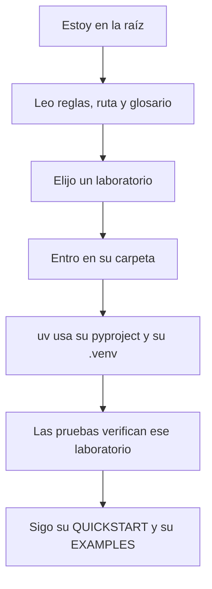

# Inicio rápido del repositorio maestro

> Esta guía reconoce el workspace y abre tu primer laboratorio en unos 15 minutos. No instala nada
> en repositorios externos ni muestra el contenido del `.env`.

## Resultado esperado

Al terminar sabrás:

- Dónde están las reglas, el plan y la ruta de aprendizaje.
- Si la configuración local existe, sin leer sus secretos.
- Qué herramientas y modelos tienes disponibles.
- Cómo preparar y verificar un laboratorio aislado.
- Qué comandos pertenecen a la raíz y cuáles al laboratorio elegido.

## 1. Abrir la raíz correcta

```powershell
Set-Location C:\Users\criss\Desktop\Claude\BL_Loops   # ajusta la ruta si tu copia vive en otro sitio
Get-Location
git status --short
```

`git status --short` es una observación, no una orden de limpiar. Todo archivo previo se conserva.

## 2. Leer el mapa mínimo

En este orden:

1. [`AGENTS.md`](../../../AGENTS.md): reglas operativas.
2. [`docs/INDEX.md`](../../INDEX.md): mapa documental.
3. [Ruta de aprendizaje](RUTA_DE_APRENDIZAJE.md): qué laboratorio hacer primero y por qué.
4. [Glosario](GLOSARIO.md): vocabulario que usan todos los laboratorios.

No hace falta leer todo `Prompts/` ni todo `docs/humano/` en cada sesión. Se consultan únicamente
las fuentes relevantes para la tarea.

## 3. Comprobar herramientas

```powershell
git --version
uv --version
node --version
npm --version
ollama --version
```

Resultado esperado: cada comando imprime una versión. Si falta una herramienta, detén la
preparación de ese componente y consulta [TROUBLESHOOTING.md](TROUBLESHOOTING.md). `node` y `npm`
solo son necesarios para los dashboards web.

## 4. Preparar la configuración compartida

Comprueba únicamente si el archivo existe:

```powershell
Test-Path -LiteralPath .env
```

Si devuelve `False`, crea la copia local:

```powershell
Copy-Item -LiteralPath .env.example -Destination .env
```

No muestres el contenido del `.env` en la terminal, en logs ni en respuestas. Su contrato público
es `.env.example`.

## 5. Comprobar Ollama y los modelos

```powershell
Invoke-RestMethod -Method Get -Uri "http://127.0.0.1:11434/api/tags" |
    Select-Object -ExpandProperty models |
    Select-Object name
```

Resultado esperado: una lista que incluya, como mínimo, `qwen3.5:4b` y `gemma4:e4b`. Esta consulta
no descarga modelos ni llama a internet. Si un modelo falta y autorizas la descarga de sus pesos:

```powershell
ollama pull qwen3.5:4b
```

`qwen3-embedding:latest` solo se necesita para los laboratorios 07 y 09.

## 6. Entrar en tu primer laboratorio

Ejemplo con el primero, que no necesita Ollama:

```powershell
Set-Location .\01-prompt-agent-factory
uv sync --all-groups
uv run pytest
uv run factory-demo --list
uv run factory-demo
```

Resultado esperado:

- `uv sync` crea `01-prompt-agent-factory/.venv`; nunca una `.venv` compartida en la raíz.
- `pytest` termina en verde sin red y sin modelo.
- `factory-demo --list` muestra los briefings de ejemplo y cuál está incompleto.
- `factory-demo` exporta un `PromptSpec` a `.local/exports/`.

Para el dashboard web, sigue la [guía propia del laboratorio](../../../01-prompt-agent-factory/docs/humano/QUICKSTART.md).

## 7. Primer comando de cada laboratorio

Desde la raíz de BL_Loops. Cada laboratorio tiene su propio `QUICKSTART.md` con el recorrido
completo y su `EXAMPLES.md` con ejemplos resueltos.

| Laboratorio | Preparar | Primer comando útil | ¿Ollama? |
|---|---|---|---|
| [01](../../../01-prompt-agent-factory/docs/humano/QUICKSTART.md) | `uv sync --all-groups` | `uv run factory-demo --all` | No |
| [02](../../../02-single-agent/docs/humano/QUICKSTART.md) | `uv sync --all-groups` | `uv run single-agent` | Sí |
| [03](../../../03-orchestration/docs/humano/QUICKSTART.md) | `uv sync --all-groups` | `uv run orchestration-demo` | Sí |
| [04](../../../04-parallel-agents/docs/humano/QUICKSTART.md) | `uv sync --all-groups` | `uv run parallel-agents-demo` | Sí |
| [05](../../../05-agent-loops/docs/humano/QUICKSTART.md) | `uv sync --all-groups` | `uv run agent-loops-demo` | Sí |
| [06](../../../06-naive-rag/docs/humano/QUICKSTART.md) | `uv sync --locked --all-groups` | `uv run naive-rag index --source .\fixtures\evaluation-corpus` | Solo `ask` |
| [07](../../../07-vector-rag/docs/humano/QUICKSTART.md) | `uv sync --locked --all-groups` | `uv run vector-rag index --source .\fixtures\evaluation-corpus` | Sí |
| [08](../../../08-graph-rag/docs/humano/QUICKSTART.md) | `uv sync --locked --all-groups` | `uv run graph-rag index --source .\fixtures\evaluation-corpus` | Solo `ask` |
| [09](../../../09-agentic-rag/docs/humano/QUICKSTART.md) | `uv sync --locked --all-groups` | `uv run sales-agent index --source .\fixtures\evaluation-corpus` | Sí |
| [13](../../../13-sales-knowledge-curator/docs/humano/QUICKSTART.md) | `uv sync --all-groups` | `uv run sales-curator doctor` | Opcional |
| [14](../../../14-local-code-hermes/docs/humano/QUICKSTART.md) | `uv sync --locked --all-groups` | `uv run hermes-preflight --mode exploratory` | Diagnóstico |
| [22](../../../22-hyperframes-video-studio/docs/humano/QUICKSTART.md) | `uv sync --all-groups` | `uv run hyperframes-studio-demo` | Opcional |
| [23](../../../23-remotion-superpowers-studio/docs/humano/QUICKSTART.md) | `uv sync --all-groups` + `npm install` | `uv run remotion-studio-demo` | Opcional |
| [24](../../../24-open-generative-ai-studio/docs/humano/QUICKSTART.md) | `uv sync --all-groups` | `uv run open-genai-demo` | Opcional |
| [25](../../../25-meeting-summarizer/docs/humano/QUICKSTART.md) | `uv sync --all-groups` | `uv run meeting-summarizer parse .\fixtures\zoom_standup.vtt` | Solo `summarize` |

Antes de cada fila, entra en la carpeta con `Set-Location .\NN-nombre`. Los laboratorios RAG
también aceptan el corpus de libros: `--source ..\docs\humano\Libros`. Ese corpus es un dato que
tú le das al comando; el runtime nunca lo lee por su cuenta.

## Mapa de puertos

Cada laboratorio con servidor usa puertos propios para poder tener varios abiertos a la vez.

| Laboratorio | API (FastAPI) | Interfaz (Vite) |
|---|---|---|
| 01 | `8011` | `5173` |
| 03 | `8012` | `5172` |
| 13 | `8013` | `5174` |
| 04 | `8014` | `5175` |
| 05 | `8015` | `5176` |
| 22 | `8022` | servida por la API en `/` |
| 23 | `8023` | servida por la API en `/` |
| 24 | `8024` | servida por la API en `/` |
| 25 | `8025` | `5177` |
| Ollama | `11434` | — |

Los laboratorios 02, 06, 07, 08, 09 y 14 son solo CLI y no abren puertos.

## Regla de orientación



Si no puedes identificar qué `pyproject.toml`, `.venv` o `package.json` está usando un comando, no
lo ejecutes todavía.
