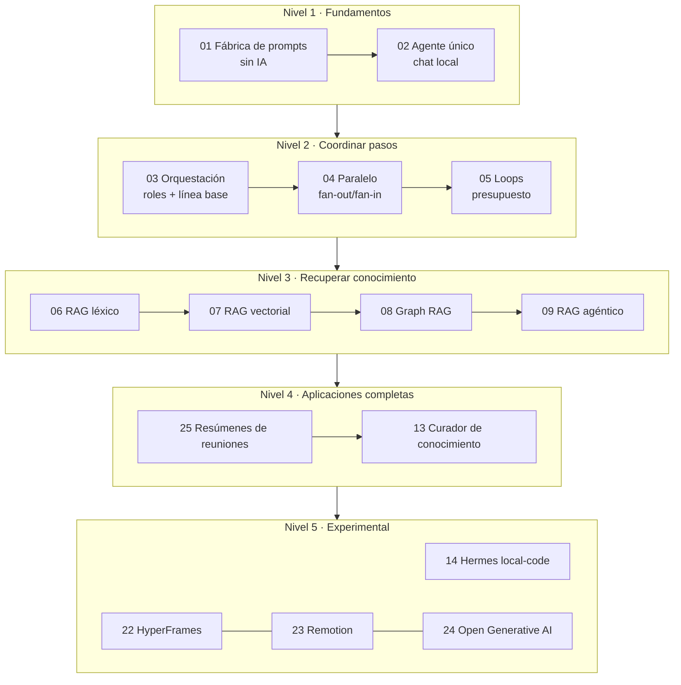

# Ruta de aprendizaje de BL_Loops

> Orden recomendado para pasar de «nunca hablé con un modelo local» a «sé comparar agentes,
> orquestaciones y RAG con evidencia». Cada etapa es un laboratorio autónomo: puedes saltarte una,
> pero entonces comprueba antes su **checkpoint**.

## Cómo usar esta ruta

1. Lee la etapa: pregunta, idea clave y requisitos.
2. Abre el `README.md` del laboratorio y sigue su «Ejecutar en 5 minutos».
3. Recorre `docs/humano/EXAMPLES.md` (ejemplos resueltos) y después `EXERCISES.md`.
4. Responde el **checkpoint** sin mirar la solución. Si fallas, repite el ejemplo indicado.
5. Avanza solo cuando puedas explicar con tus palabras qué entró, qué pasó en cada estado y qué
   evidencia demuestra el resultado.

Los tiempos son orientativos para una primera pasada con los modelos ya descargados.

## Mapa general

## Nivel 0 · Preparación (30 min)

| Paso | Qué haces | Dónde |
|---|---|---|
| Vocabulario | Lee las secciones 1 y 2 del glosario | [GLOSARIO.md](GLOSARIO.md) |
| Herramientas | Comprueba `git`, `uv`, `node`, `ollama` | [QUICKSTART.md](QUICKSTART.md) |
| Modelos | `ollama list` debe mostrar `qwen3.5:4b` y `gemma4:e4b` | [QUICKSTART.md](QUICKSTART.md) |
| Reglas | Entiende por qué los laboratorios no se conectan entre sí | [ARCHITECTURE.md](ARCHITECTURE.md) |

`qwen3-embedding:latest` solo hace falta a partir del laboratorio 07.

## Nivel 1 · Fundamentos

### Etapa 1 · `01-prompt-agent-factory` (45 min)

- **Pregunta:** ¿por qué una idea todavía no es un prompt?
- **Idea clave:** un artefacto útil tiene contrato, límites, condiciones de parada y huella.
- **Requisitos:** ninguno de IA; funciona sin Ollama.
- **Al terminar podrás:** convertir un briefing en `PromptSpec`, `AgentSpec` o `SkillSpec`, y
  explicar qué preguntas hacen falta cuando el briefing está incompleto.
- **Práctica estrella:** `uv run factory-demo --intake incomplete_agent_brief.json`.

Checkpoint: ¿qué diferencia hay entre una lista de tools vacía y una lista olvidada?

Una lista vacía **confirmada** (`tools_confirmed: true`) es una decisión de seguridad: el agente no
tiene herramientas. Una lista olvidada es un hueco de autoridad: nadie decidió qué puede hacer el
agente. Por eso la fábrica pregunta `tools_confirmed` antes de construir un agente o una skill.

### Etapa 2 · `02-single-agent` (30 min)

- **Pregunta:** ¿cuál es el camino mínimo para conversar con un modelo local?
- **Idea clave:** la «memoria» es una lista de mensajes que se reenvía completa en cada turno.
- **Requisitos:** Ollama con `gemma4:e4b`.
- **Al terminar podrás:** explicar por qué el modelo recuerda un dato, por qué lo olvida al usar
  `/olvidar` y cómo crece el contexto turno a turno con `/memoria`.

Checkpoint: si cierras el chat y lo abres de nuevo, ¿por qué el modelo ya no recuerda tu dato?

Porque el historial vivía solo en la RAM del proceso. Al cerrarlo, la lista desaparece y el nuevo
proceso empieza con solo la instrucción de sistema. El modelo nunca “guardó” nada: solo recibe lo
que el programa le envía en cada llamada.

## Nivel 2 · Coordinar varios pasos

### Etapa 3 · `03-orchestration` (60 min)

- **Pregunta:** ¿qué mejora realmente al separar una tarea entre roles?
- **Idea clave:** sin línea base no hay mejora demostrable; el aprobado lo decide código.
- **Requisitos:** Ollama con `qwen3.5:4b`; Node.js para el dashboard (opcional).
- **Al terminar podrás:** leer un handoff `Plan`, explicar el gate determinista y decidir un
  ganador con la regla de comparación del laboratorio.

Checkpoint: el revisor LLM dice «aprobado» pero el gate falla. ¿Quién manda?

El gate determinista. La opinión del revisor se registra (`llm_review_passed`), pero el aprobado
sale de `score_guide()`, que siempre da el mismo veredicto para el mismo texto. Un modelo no puede
ponerse la nota a sí mismo.

### Etapa 4 · `04-parallel-agents` (45 min)

- **Pregunta:** ¿cuándo el paralelismo reduce tiempo sin perder procedencia?
- **Idea clave:** dibujar tres nodos en ámbar no significa que haya tres llamadas a la vez.
- **Requisitos:** Ollama con `qwen3.5:4b`; Node.js para el dashboard (opcional).
- **Al terminar podrás:** calcular un speedup, interpretar `overlap_observed` y explicar por qué
  una rama fallida no puede aparecer como completa.

Checkpoint: con <code>PARALLEL_MAX_IN_FLIGHT=1</code>, ¿qué speedup esperas y por qué?

Cercano a 1. Con una sola llamada en curso, las tres ramas se atienden en cola: el “paralelo” hace
el mismo trabajo que el secuencial y `overlap_observed` queda en `false`. El laboratorio lo enseña a
propósito para que no confundas concurrencia dibujada con concurrencia real.

### Etapa 5 · `05-agent-loops` (45 min)

- **Pregunta:** ¿cómo mejorar con repeticiones sin quedar atrapado?
- **Idea clave:** declarar objetivo, presupuesto y parada **antes** de la primera llamada, y
  conservar el mejor candidato, no el último.
- **Requisitos:** Ollama con `qwen3.5:4b`.
- **Al terminar podrás:** predecir el `stop_reason` de un loop y puntuar una salida con las cinco
  assertions sin llamar al modelo.

Checkpoint: puntuaciones 2 → 4 → 3 y se agota el presupuesto. ¿Qué candidato se entrega?

El de la iteración 2, con 4 checks. El laboratorio guarda el máximo visto; la última iteración
empeoró. El motivo de salida (`max_iterations`, `max_errors`, `timeout` o `threshold_reached`)
queda registrado en el snapshot y en el JSONL.

## Nivel 3 · Recuperar conocimiento (RAG)

### Etapa 6 · `06-naive-rag` (45 min)

- **Pregunta:** ¿cuánto aporta buscar palabras antes de generar?
- **Idea clave:** recuperar → aumentar → generar, con citas a archivo y líneas.
- **Requisitos:** `index` y `search` funcionan sin Ollama; `ask` necesita `qwen3.5:4b`.
- **Al terminar podrás:** inspeccionar con `naive-rag search` el contexto exacto que recibiría el
  modelo y explicar por qué aparecen un documento obsoleto y un distractor.

Checkpoint: ¿por qué «luna» trae un documento sobre satélites?

Porque FTS5 compara palabras, no significados. `05-distractor.md` contiene «luna» y suma puntuación
BM25 aunque no hable de ventas. Ese límite es la razón de ser del laboratorio 07.

### Etapa 7 · `07-vector-rag` (60 min)

- **Pregunta:** ¿cuándo la similitud semántica supera la búsqueda por palabras?
- **Idea clave:** un embedding representa significado; la fusión RRF combina rankings sin igualar
  escalas.
- **Requisitos:** Ollama con `qwen3-embedding:latest` y `qwen3.5:4b`.
- **Al terminar podrás:** comparar los modos `lexical`, `vector` e `hybrid` con la misma
  paráfrasis y calcular a mano una puntuación RRF.

Checkpoint: un fragmento es 1.º en léxico y 3.º en vectorial. ¿Cuál es su RRF?

`0.35 / (60 + 1) + 0.65 / (60 + 3) ≈ 0.00574 + 0.01032 = 0.01606`. Aparecer en ambos rankings suma;
por eso un fragmento “bueno en los dos” suele ganar a uno excelente solo en uno.

### Etapa 8 · `08-graph-rag` (60 min)

- **Pregunta:** ¿cuándo las relaciones explícitas justifican construir un grafo?
- **Idea clave:** algunas respuestas no viven en un solo fragmento; hay que encadenar aristas.
- **Requisitos:** `index` y `search` funcionan sin Ollama; `ask` necesita `qwen3.5:4b`.
- **Al terminar podrás:** seguir una ruta de tres saltos, distinguir aristas `extracted` de
  `inferred` y explicar por qué el ranking léxico pierde el eslabón intermedio.

Checkpoint: ¿por qué la arista inferida no se guarda en SQLite?

Porque nadie la escribió en un documento: es una conclusión compuesta al consultar. Guardarla la
convertiría en un “hecho” sin cita. Las aristas extraídas sí tienen archivo y línea de origen.

### Etapa 9 · `09-agentic-rag` (60 min)

- **Pregunta:** ¿puede el agente decidir qué buscar sin perder control?
- **Idea clave:** el modelo propone la llamada; el runtime autoriza como máximo una búsqueda y, si
  la llamada es inválida, usa un fallback determinista registrado.
- **Requisitos:** Ollama con `qwen3.5:4b` y `qwen3-embedding:latest`.
- **Al terminar podrás:** leer una tool call en la traza, reconocer un `runtime_fallback` y
  explicar por qué un corpus débil limita al agente aunque el modelo sea bueno.

Checkpoint: ¿qué diferencia hay entre el 07 y el 09 si ambos usan búsqueda híbrida?

En el 07 el **programa** decide buscar con la pregunta literal. En el 09 el **modelo** formula la
consulta mediante tool calling y el runtime limita y valida esa decisión. La recuperación es la
misma familia; cambia quién decide y cuánta autonomía se concede.

## Nivel 4 · Aplicaciones completas

### Etapa 10 · `25-meeting-summarizer` (60 min)

- **Pregunta:** ¿cómo convertir una transcripción larga en decisiones y compromisos verificables?
- **Idea clave:** normalizar formatos distintos, dividir con solapamiento y extraer con contrato.
- **Requisitos:** `parse` funciona sin Ollama; `summarize` necesita `qwen3.5:9b` o `qwen3.5:4b`.
- **Al terminar podrás:** explicar el umbral entre resumen directo y map-reduce, y detectar un
  compromiso sin responsable.

Checkpoint: ¿por qué se solapan los bloques al dividir una reunión larga?

Para no cortar una frase o un compromiso por la mitad. Si «Marta enviará el informe» cae justo en
el borde, el solapamiento garantiza que al menos un bloque lo contenga completo.

### Etapa 11 · `13-sales-knowledge-curator` (90 min)

- **Pregunta:** ¿cómo publicar conocimiento trazable sin declarar que el modelo sabe la verdad?
- **Idea clave:** cada afirmación tiene procedencia; los conflictos se muestran; la publicación
  exige aprobación humana sobre un hash exacto.
- **Requisitos:** la demo funciona sin Ollama (extractor determinista).
- **Al terminar podrás:** recorrer auditoría → staging → aprobación → release y explicar por qué
  una afirmación con instrucciones inyectadas queda excluida.

Checkpoint: ¿por qué la demo se detiene en <code>state=staging</code>?

Porque publicar es una decisión humana. La demo prepara un candidato con `candidate_hash`; solo
`release publish --expected-hash <hash>` lo publica. Si el candidato cambió, el hash no coincide y
la publicación se rechaza.

## Nivel 5 · Experimental

Estos laboratorios exigen más hardware, herramientas externas o autorizaciones. Empieza por su
modo de diagnóstico o demostración.

| Laboratorio | Qué enseña | Requisito principal |
|---|---|---|
| [`14-local-code-hermes`](../../../14-local-code-hermes/README.md) | Preflight, sandbox sin red y cohortes comparables | Python 3.12; Hermes, Docker y modelo 64k solo para la corrida viva |
| [`22-hyperframes-video-studio`](../../../22-hyperframes-video-studio/README.md) | Director LLM + composición HTML escapada + lint + render | Node.js 22+ y FFmpeg; red la primera vez (HyperFrames y su Chrome headless) |
| [`23-remotion-superpowers-studio`](../../../23-remotion-superpowers-studio/README.md) | Escenas, fotogramas y video programático con React | Node.js 22+, `npm ci` del laboratorio y FFmpeg |
| [`24-open-generative-ai-studio`](../../../24-open-generative-ai-studio/README.md) | Idea → storyboard validado → animatic con FFmpeg | FFmpeg con `ffprobe`; nada de Node.js |

Checkpoint: ¿por qué un endpoint en 127.0.0.1 no demuestra «cero egress»?

Porque solo garantiza adónde van las llamadas de inferencia. El cliente o sus subprocesos podrían
abrir otras conexiones. «Cero egress» exige evidencia de red independiente del árbol de procesos.

## Rutas alternativas

### Ruta sin Ollama (ideal para leer el código o trabajar sin GPU)

Todo esto funciona con el modelo apagado y enseña la mitad determinista de cada sistema:

| Laboratorio | Qué puedes ejecutar | Qué aprendes |
|---|---|---|
| 01 | `factory-demo --all`, API y dashboard completos | Contratos, preguntas guiadas, huella |
| 02 | `/ayuda`, `/memoria`, `/olvidar`, `single-agent-validate` | Historial y traza sin modelo |
| 03 | Ejemplos de `score_guide()` en su `EXAMPLES.md` | Gate determinista |
| 04 | Ejemplos de `score_bundle()` y `join_branches()` | Procedencia y fan-in |
| 05 | Ejemplos de `score_output()` | Assertions del loop |
| 06 | `naive-rag index` + `naive-rag search` | BM25, top-k y abstención |
| 08 | `graph-rag index` + `graph-rag search --mode compare` | Rutas multi-hop |
| 13 | `sales-curator demo` | Claims, conflictos y staging |
| 25 | `meeting-summarizer parse` | Normalización de transcripciones y plan de bloques |

### Ruta rápida de RAG (medio día)

`06 → 07 → 08 → 09`, usando siempre la misma pregunta de ventas para comparar qué recupera cada
variante antes de mirar la respuesta generada.

### Ruta de coordinación (medio día)

`02 → 03 → 04 → 05`, anotando en una tabla `checks`, tokens y tiempo de pared de cada corrida.

## Tabla resumen

| # | Laboratorio | Nivel | Tiempo | Interfaz | Modelo por defecto | Necesita Ollama |
|---|---|---|---|---|---|---|
| 01 | [prompt-agent-factory](../../../01-prompt-agent-factory/README.md) | 1 | 45 min | Web + CLI | — | No |
| 02 | [single-agent](../../../02-single-agent/README.md) | 1 | 30 min | CLI | `gemma4:e4b` | Sí |
| 03 | [orchestration](../../../03-orchestration/README.md) | 2 | 60 min | Web + CLI | `qwen3.5:4b` | Sí |
| 04 | [parallel-agents](../../../04-parallel-agents/README.md) | 2 | 45 min | Web + CLI | `qwen3.5:4b` | Sí |
| 05 | [agent-loops](../../../05-agent-loops/README.md) | 2 | 45 min | Web + CLI | `qwen3.5:4b` | Sí |
| 06 | [naive-rag](../../../06-naive-rag/README.md) | 3 | 45 min | CLI | `qwen3.5:4b` | Solo `ask` |
| 07 | [vector-rag](../../../07-vector-rag/README.md) | 3 | 60 min | CLI | `qwen3.5:4b` + embeddings | Sí |
| 08 | [graph-rag](../../../08-graph-rag/README.md) | 3 | 60 min | CLI | `qwen3.5:4b` | Solo `ask` |
| 09 | [agentic-rag](../../../09-agentic-rag/README.md) | 3 | 60 min | CLI | `qwen3.5:4b` + embeddings | Sí |
| 25 | [meeting-summarizer](../../../25-meeting-summarizer/README.md) | 4 | 60 min | Web + CLI | `qwen3.5:9b` | Solo `summarize` |
| 13 | [sales-knowledge-curator](../../../13-sales-knowledge-curator/README.md) | 4 | 90 min | Web + CLI | determinista | Opcional |
| 14 | [local-code-hermes](../../../14-local-code-hermes/README.md) | 5 | 60 min | CLI | `local-code-9b-64k` | Corrida viva |
| 22 | [hyperframes-video-studio](../../../22-hyperframes-video-studio/README.md) | 5 | 45 min | Web + CLI | `qwen3.5:9b` | Opcional* |
| 23 | [remotion-superpowers-studio](../../../23-remotion-superpowers-studio/README.md) | 5 | 45 min | Web + CLI | `qwen3.5:9b` | Opcional* |
| 24 | [open-generative-ai-studio](../../../24-open-generative-ai-studio/README.md) | 5 | 45 min | Web + CLI | `qwen3.5:9b` | Opcional* |

\* Sin Ollama, los estudios 22–24 usan contenido calibrado y lo **declaran** como fallback en sus
eventos; no sustituyen el modelo por un servicio externo.

## Siguiente paso

Cuando termines un nivel, repite su experimento con otro modelo de la escalera (`qwen3.5:4b`,
`gemma4:e2b`, `qwen3.5:9b`, `gemma4:e4b`) y compara las trazas JSONL. Esa comparación, no la
impresión subjetiva, es la que responde «qué modelo es mejor para esta tarea».
